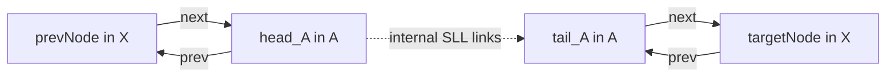
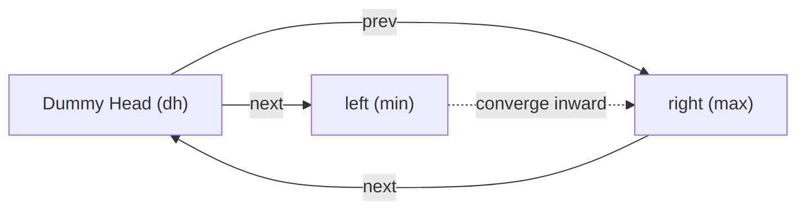

# CSE 220: Data Structures — Midterm Practice Problems & Minimal Sets

> **Executive Objective**: Eliminate massive problem redundancy across previous semesters' midterm and lab quiz problem sets (`Stack & Queue.pdf`, `Doubly Linked List.pdf`, and `Array.pdf`). Master all data structure invariants, pointer manipulations, modular operations, and theoretical proofs by solving the **absolute minimal set of representative master problems**.
>
> **Strict Constraints**:
> - Zero study plans — 100% rigorous technical breakdown, mathematical proofs, deduplication matrices, and production-grade Java blueprints.
> - Preserves all invariants of singly, doubly, and circular dummy-headed linked list structures.
> - All Java implementations strictly compile and verify against the project test harness in `src/com/study/app/`.

---

## Table of Contents
1. [Part I: Stack & Queue Practice Problems](#part-i-stack--queue-practice-problems)
   - [Executive Problem Reduction Matrix](#1-executive-problem-reduction-matrix)
   - [Core Stack Problems (1 to 8)](#2-core-stack-problems)
   - [Queue & Hybrid Systems (Queue 1 & 2)](#3-queue--hybrid-systems)
   - [Midterm Theory, Memory & MCQs](#4-midterm-theory-memory--mcqs)
2. [Part II: Doubly Linked List Practice Problems](#part-ii-doubly-linked-list-practice-problems)
   - [Executive Problem Reduction Matrix](#part-ii-executive-problem-reduction-matrix)
   - [Theory & Trace Master: Cyclic Rotations & Memory Models](#part-ii-theory--trace-master)
   - [Core 1: Modular Deletion in Dummy DLL (`removesClient`)](#core-1-modular-deletion-in-dummy-dll)
   - [Core 2: Hybrid SLL-to-CDLL Intersplicing (`insertList`)](#core-2-hybrid-sll-to-cdll-intersplicing)
   - [Core 3: Consecutive Duplicate Deduplication in CDLL (`multiDelete`)](#core-3-consecutive-duplicate-deduplication)
   - [Core 4: In-Place Subsegment Pointer Inversion (`reverseDLLSubsegment`)](#core-4-in-place-subsegment-pointer-inversion)
   - [Core 5: Stable Parity Segregation (`rearrangeByParity`)](#core-5-stable-parity-segregation)
   - [Core 6: Bidirectional Two-Pointer Convergence on CDLL (`isPalindrome` & `findPair`)](#core-6-bidirectional-two-pointer-convergence)
   - [Core 7: Subsequence Overlap Detection & In-Place Removal (`removeOverlaps`)](#core-7-subsequence-overlap-detection--removal)
   - [Core 8: Adjacent Pair Merge & Node Relocation (`minAdjacentPairMerge` & `moveMinToMiddle`)](#core-8-adjacent-pair-merge--node-relocation)
   - [Core 9: Matrix Anti-Diagonal to DLL Synthesis (`autonomousMapping`)](#core-9-matrix-anti-diagonal-to-dll-synthesis)
3. [Part III: Array & 2D Matrix Practice Problems](#part-iii-array--2d-matrix-practice-problems)
   - [Executive Problem Reduction Matrix](#part-iii-executive-problem-reduction-matrix)
   - [Theory Master: Multi-Dimensional Array Addressing & Row-Major Mapping](#part-iii-theory-master)
   - [Core 1: 2x2 Spatial Block Pooling / Matrix Compression (`compressMatrix`)](#core-1-2x2-spatial-block-pooling--matrix-compression)
   - [Core 2: Column Reductions & Subsequent Differences (`sumDiff`, `quizDifferences`, `salesPercentages`)](#core-2-column-reductions--subsequent-differences)
   - [Core 3: Boundary Ring & Column Safe Rotations (`rotateOuterRingAnticlockwise` & `unlockSafe`)](#core-3-boundary-ring--column-safe-rotations)
   - [Core 4: Full In-Place Matrix Rotations 90° (`rotateImage90Clockwise` & `rotateImage90CounterClockwise`)](#core-4-full-in-place-matrix-rotations-90)
   - [Core 5: Anti-Diagonal Zigzag & Symmetric Palindromic Scanning (`zigzagAntiDiagonal`, `decodeMessagePrimary`, `decodeMessageSecondary`)](#core-5-anti-diagonal-zigzag--symmetric-palindromic-scanning)
   - [Core 6: Extremum Intersection Localization (`findQueenAge` & `findStrongSource`)](#core-6-extremum-intersection-localization)
   - [Core 7: In-Place Triangular Matrix Folding (`toSymLowerTri` & `toSymUpperTri`)](#core-7-in-place-triangular-matrix-folding)
   - [Core 8: Dual-Diagonal Symmetric Pin Decryption (`decodePinDiff` & `decodePinAvg`)](#core-8-dual-diagonal-symmetric-pin-decryption)
   - [Core 9: Snake Dungeon Traversal to Singly Linked List (`zigzagList`)](#core-9-snake-dungeon-traversal-to-singly-linked-list)
   - [Core 10: Rover Local Minimum with Noise Rejection (`localMinima`)](#core-10-rover-local-minimum-with-noise-rejection)
   - [Core 11: Directional Diagonal Raycasting Energy Grid (`blockEnergySum`)](#core-11-directional-diagonal-raycasting-energy-grid)

---

# Part I: Stack & Queue Practice Problems

> **Core Objective**: Eliminate massive problem redundancy across previous semesters' midterm and lab quiz problem sets (`Stack & Queue.pdf`). Master all stack/queue manipulation techniques, invariant preservation, boundary handling, and theory proofs by solving the **absolute minimal set of representative problems**.
>
> **Scope & Ground Rules**:
> - Adheres strictly to the standard interface: `push()`, `pop()`, `peek()`, `isEmpty()` for `Stack`, and `enq()`, `deq()`, `peek()`, `isEmpty()` for `Queue`.
> - Direct pointer manipulation to `top` or internal nodes is strictly forbidden unless explicitly asked in theory questions.
> - No secondary built-in data structures (such as `ArrayList`, arrays, or Java Collections) are permitted unless explicitly permitted by the problem statement.
> - **Zero Study Plans**: Pure technical breakdown, deduplication matrices, mathematical proofs, and Java blueprints.

---

## 1. Executive Problem Reduction Matrix

Across the 24 problems in `Stack & Queue.pdf`, over 60% of problems are trivial variations or exact duplicates of foundational patterns. The entire sheet is compressed into **8 Core Stack Problems**, **2 Stack-Queue Cooperation Systems**, and **1 Comprehensive Theory Master**.

| Master ID | Problem Title & Scope | Subsumes / Replaces | Core Pattern & Invariant | Time | Aux Space |
| :--- | :--- | :--- | :--- | :--- | :--- |
| **Core 1** | **Problem 20**: `evalMathExpression` | Parentheses Balance, Infix $	o$ Postfix, Postfix Eval | Operator precedence, bracket matching, single Stack + single Queue constraint | $O(N)$ | $O(N)$ |
| **Core 2** | **Problem 24**: `mergeStacks` | Sorted Stack Merging | Two-pointer simulation using stack inversion; maintains non-decreasing order | $O(N + M)$ | $O(N + M)$ |
| **Core 3** | **Problem 14**: `rearrange_by_sum` | **Problem 17** (`segregate`), **Problem 2** | Conditional multi-pass parity aggregation, dual auxiliary buffering, stable order preservation | $O(N)$ | $O(N)$ |
| **Core 4** | **Problem 9**: `rearrange_odd_even_alternating` | Parity Interleave | Dual FIFO simulation via double-stack inversion; strictly alternates odd/even | $O(N)$ | $O(N)$ |
| **Core 5** | **Problem 10 & 12**: Modular Rotation (`rotate_stack`) | Upward & Downward Rotation | Large $k$ reduction ($k \pmod N$ for $k \le 10^9$); 2-stack partition and splice | $O(N)$ | $O(N)$ |
| **Core 6** | **Problem 7 & 15**: Segment Reverse (`conditional_reverse_range`) | **Problem 11** (`retain_and_reverse`) | Targeted subsegment reversal (top-$n$ or bottom-$n$) with depth isolation | $O(N)$ | $O(N)$ |
| **Core 7** | **Problem 8 & 13**: Symmetric Top-Bottom Folding (`sum_stack` / `sub_stack`) | Pairwise Arithmetic Folding | Midpoint split, inversion, and simultaneous top-bottom folding | $O(N)$ | $O(N)$ |
| **Core 8** | **Problem 5**: Interval Merging (`print_total_task`) | Interval Scheduling / Stack Monotonicity | Greedy interval merging using stack top boundary expansion; descending output dump | $O(N)$ | $O(N)$ |
| **Queue 1** | **Problem 3**: `dance_pair` | Stack $\leftrightarrow$ Queue Cooperation | Streaming partner matching, surplus queue buffer, asymmetric fallback discard | $O(N)$ | $O(N)$ |
| **Queue 2** | **Problem 23**: `CallQueue` | Multi-tier Priority Queue | Two-queue FIFO arbitration (VIP priority with regular fallback) | $O(1)$ ops | $O(N)$ |
| **Theory** | **Problem 18 & 19**: Theory, Memory & MCQs | Midterm Conceptual Questions | 3D $\to$ 2D linear indexing, separate chaining vs. linked list space, Top-at-Head $O(N)$ pop penalty | — | — |

---

## 2. Complete Categorization & Deduplication Audit

### Category 1: Filtering, Reversals & Inversion Boundaries
* **Problem 2 & Problem 22 (`conditional_reverse`)**: Reverses a stack while filtering consecutive duplicate values. (Problem 22 is an exact verbatim duplicate of Problem 2).
* **Problem 11 (`retain_and_reverse_stack`)**: Retains top $m$ elements, discards the rest, and reverses the retained elements.
* **Problem 7 (`conditional_reverse` top-$n$)**: Reverses only the top $n$ elements, leaving the remaining bottom elements undisturbed.
* **Problem 15 (`conditional_reverse` bottom-$n$)**: Reverses only the bottom $n$ elements, leaving the top elements undisturbed.
* **Problem 21 (`removeConsecutiveDups` using Queue)**: Filters consecutive duplicate characters from a string using a Queue.
> **Deduplication Decision**:
> - **Problem 11** is a trivial subset of **Problem 7** (discarding elements is strictly simpler than preserving bottom elements).
> - **Problem 22** is an exact duplicate of **Problem 2**.
> - **Select Problem 7 & 15 Synthesis** as the master problem for segment reversal, and **Problem 2 / 21** for duplicate elimination.

### Category 2: Parity Partitioning & Relative Order Stability
* **Problem 17 (`segregate`)**: Moves all odd numbers to top and even numbers to bottom, preserving relative arrival order.
* **Problem 14 (`rearrange_by_sum`)**: Computes $\sum \text{odd}$ and $\sum \text{even}$. If $\sum \text{even} > \sum \text{odd}$, evens go to top; otherwise odds go to top. Preserves relative arrival order.
* **Problem 9 (`rearrange_odd_even_alternating`)**: Alternates odd and even elements with an odd number on top, while strictly maintaining relative arrival order.
> **Deduplication Decision**:
> - **Problem 17** is strictly subsumed by **Problem 14** (Problem 17 is merely the static condition of Problem 14 without the sum computation).
> - **Select Problem 14** (conditional block partitioning) and **Problem 9** (alternating interleave).

### Category 3: Symmetric Top-Bottom Pairwise Arithmetic
* **Problem 8 (`sum_stack`)**: Pairs $top_i$ with $bottom_i$ and stores their sums: $\text{top}[0] + \text{bottom}[0], \dots$.
* **Problem 13 (`sub_stack`)**: Pairs $top_i$ with $bottom_i$ and stores their differences: $\text{top}[i] - \text{bottom}[i]$.
> **Deduplication Decision**:
> - **Problem 8** and **Problem 13** share 100% identical structural logic (bisecting the stack, flipping halves, and pairwise reduction). Solving one solves both.
> - **Select Problem 8** (with parameterizable binary operation).

### Category 4: Large Modular Cyclic Shifts
* **Problem 10 (`rotate_stack` upward)**: Shifts elements upward by $k$ positions where $0 < k < 10^9$.
* **Problem 12 (`rotate_stack` downward)**: Shifts elements downward by $k$ positions where $0 < k < 10^9$.
> **Deduplication Decision**:
> - Downward rotation by $k$ on a stack of size $N$ is mathematically equivalent to upward rotation by $(N - (k \pmod N)) \pmod N$.
> - **Select Problem 10 & 12 Unified Solution** covering modular reduction for $k \le 10^9$ and bidirectional shifts.

### Category 5: Multi-Stack Sorting & Merging
* **Problem 6 (`filter_and_sort_stack`)**: Filters elements $> k$ and sorts remaining elements in ascending order using auxiliary stacks.
* **Problem 24 (`mergeStacks`)**: Merges two already sorted stacks into a single sorted stack in $O(N+M)$ time.
* **Problem 4 (`Do_Adjacent_Swap`)**: Swaps adjacent pairs from top to bottom, handling odd/even length edge cases.
> **Deduplication Decision**:
> - **Problem 24** teaches linear two-pointer merging on stacks.
> - **Problem 6** teaches insertion sort on stacks using $O(N^2)$ time with auxiliary stack buffering.
> - **Problem 4** handles local pairwise index manipulation.
> - **Retain Problems 4, 6, and 24**.

### Category 6: Stream Processing, Interval Merging & Windowing
* **Problem 5 (`print_total_task`)**: Merges overlapping intervals sorted by start time using a stack; outputs in descending order.
* **Problem 18 (`depositSum`)**: Chunked sliding window summation of positive values (deposits) over a transaction stream.
> **Deduplication Decision**:
> - **Problem 5** is the classic Interval Merging problem mapped onto stack LIFO mechanics.
> - **Problem 18** represents fixed-window stream reduction.
> - **Retain both Problems 5 and 18**.

### Category 7: Stack & Queue Hybrid Systems
* **Problem 3 (`dance_pair`)**: Male/female sequential pairing, spare buffering via Queue, unmatched fallback discard.
* **Problem 23 (`CallQueue`)**: Dual-queue priority scheduling (VIP FIFO + Regular FIFO).
> **Deduplication Decision**:
> - Both test the fundamental distinction between LIFO (reversal, backtracking) and FIFO (buffering, arrival-order preservation).
> - **Retain both Problems 3 and 23**.

### Category 8: Expression Parsing & Evaluation
* **Problem 20 (`evalMathExpression`)**: Complete parsing pipeline: balanced bracket validation, Infix to Postfix conversion, and Postfix evaluation under single Stack + single Queue constraint.
> **Deduplication Decision**:
> - The capstone problem for CSE 220. Subsumes all basic parentheses and expression evaluation problems.

---

## 3. Deep-Dive Solutions & Blueprints for the Minimal Problem Set

All Java implementations below are designed for direct integration with `com.study.app.Stack` (and a standard `Queue` interface).

```java
package com.study.app;

// Assumed Queue interface for hybrid problems
public class Queue {
    private Node front, rear;
    public boolean isEmpty() { return front == null; }
    public void enq(int val) {
        Node n = new Node(val);
        if (rear == null) { front = rear = n; }
        else { rear.next = n; rear = n; }
    }
    public Integer deq() {
        if (isEmpty()) return null;
        int val = front.elem;
        front = front.next;
        if (front == null) rear = null;
        return val;
    }
    public Integer peek() { return isEmpty() ? null : front.elem; }
}
```

---

### Core 1: Expression Validation, Infix-to-Postfix & Evaluation (Problem 20)

#### Mathematical & Algorithmic Blueprint
1. **Bracket Validation**:
   - Push opening brackets `(`, `[`, `{` to Stack.
   - For closing brackets, check if stack is empty or top does not match corresponding opening bracket. If mismatch, return `"Invalid Expression"`.
2. **Infix to Postfix Conversion**:
   - Operands are enqueued directly into the output Queue.
   - Operators are pushed to the Stack based on precedence:
     $$\text{prec}(*) = \text{prec}(/) = 2, \quad \text{prec}(+) = \text{prec}(-) = 1$$
   - When encountering an operator $op$, pop all operators from Stack to Queue while $\text{prec}(\text{stack.peek()}) \ge \text{prec}(op)$.
   - Parentheses act as precedence barriers: `(` is pushed directly; `)` pops everything to Queue until `(` is reached and discarded.
3. **Postfix Evaluation**:
   - Iterate through the Postfix Queue. Numbers are pushed onto the evaluation Stack.
   - For operator $op$: pop $b$, pop $a$, compute $a \; op \; b$, and push result back onto Stack.
   - Final value on Stack is the evaluated result.

#### Java Implementation
```java
public static void evalMathExpression(String expr) {
    // 1. Validate Parentheses
    Stack parenStack = new Stack();
    for (int i = 0; i < expr.length(); i++) {
        char ch = expr.charAt(i);
        if (ch == '(' || ch == '[' || ch == '{') {
            parenStack.push(ch);
        } else if (ch == ')' || ch == ']' || ch == '}') {
            if (parenStack.isEmpty()) {
                System.out.println("Invalid Expression");
                return;
            }
            int top = parenStack.pop();
            if ((ch == ')' && top != '(') ||
                (ch == ']' && top != '[') ||
                (ch == '}' && top != '{')) {
                System.out.println("Invalid Expression");
                return;
            }
        }
    }
    if (!parenStack.isEmpty()) {
        System.out.println("Invalid Expression");
        return;
    }

    // 2. Infix to Postfix (tokenizing single-digit integers & operators)
    // NB: Using 1 Stack and 1 Queue as constrained
    Stack opStack = new Stack();
    // Using Queue for postfix token output (represented with character codes)
    Queue postQueue = new Queue();

    for (int i = 0; i < expr.length(); i++) {
        char ch = expr.charAt(i);

        if (Character.isDigit(ch)) {
            postQueue.enq(ch);
        } else if (ch == '(' || ch == '[' || ch == '{') {
            opStack.push(ch);
        } else if (ch == ')' || ch == ']' || ch == '}') {
            char openTarget = (ch == ')') ? '(' : (ch == ']') ? '[' : '{';
            while (!opStack.isEmpty() && opStack.peek() != openTarget) {
                postQueue.enq(opStack.pop());
            }
            if (!opStack.isEmpty()) opStack.pop(); // remove opening bracket
        } else if (isOperator(ch)) {
            while (!opStack.isEmpty() && precedence((char)(int)opStack.peek()) >= precedence(ch)) {
                postQueue.enq(opStack.pop());
            }
            opStack.push(ch);
        }
    }
    while (!opStack.isEmpty()) {
        postQueue.enq(opStack.pop());
    }

    // Print Postfix
    StringBuilder sb = new StringBuilder();
    Queue evalQueue = new Queue(); // clone/forward queue for evaluation
    while (!postQueue.isEmpty()) {
        int token = postQueue.deq();
        sb.append((char) token);
        evalQueue.enq(token);
    }
    System.out.println("Postfix: " + sb.toString());

    // 3. Postfix Evaluation
    Stack evalStack = new Stack();
    while (!evalQueue.isEmpty()) {
        int token = evalQueue.deq();
        char ch = (char) token;
        if (Character.isDigit(ch)) {
            evalStack.push(ch - '0');
        } else if (isOperator(ch)) {
            int b = evalStack.pop();
            int a = evalStack.pop();
            evalStack.push(applyOp(a, b, ch));
        }
    }
    System.out.println("Result: " + evalStack.pop());
}

private static boolean isOperator(char c) {
    return c == '+' || c == '-' || c == '*' || c == '/';
}

private static int precedence(char c) {
    if (c == '*' || c == '/') return 2;
    if (c == '+' || c == '-') return 1;
    return 0; // for brackets
}

private static int applyOp(int a, int b, char op) {
    switch (op) {
        case '+': return a + b;
        case '-': return a - b;
        case '*': return a * b;
        case '/': return a / b;
    }
    return 0;
}
```

---

### Core 2: Merging Two Sorted Stacks (Problem 24)

#### Algorithmic Invariant
- **Input**: `stack1` and `stack2` sorted in **non-decreasing** order from top to bottom (i.e., top is smallest element).
- **Target**: Merged stack also sorted in non-decreasing order from top to bottom.
- **Mechanism**:
  - Directly comparing `stack1.peek()` and `stack2.peek()` and pushing the smaller to an auxiliary stack `temp` puts the smallest elements at the bottom of `temp` (descending order in `temp`).
  - Once both inputs are exhausted, popping from `temp` back into `result` restores the smallest elements back to the top!
  - **Time Complexity**: Exactly $O(N + M)$ single-pass comparisons.
  - **Space Complexity**: $O(N + M)$ auxiliary stack.

```java
public static Stack mergeStacks(Stack stack1, Stack stack2) {
    Stack temp = new Stack();

    // Greedily pop the smaller top element into temp
    while (!stack1.isEmpty() && !stack2.isEmpty()) {
        if (stack1.peek() <= stack2.peek()) {
            temp.push(stack1.pop());
        } else {
            temp.push(stack2.pop());
        }
    }
    while (!stack1.isEmpty()) temp.push(stack1.pop());
    while (!stack2.isEmpty()) temp.push(stack2.pop());

    // Invert temp into result to place smallest elements back on top
    Stack result = new Stack();
    while (!temp.isEmpty()) {
        result.push(temp.pop());
    }
    return result;
}
```

---

### Core 3: Conditional Parity Partitioning by Sum (Problem 14)
*Subsumes Problem 17 (`segregate`).*

#### Invariant & Dual-Buffer Preservation
1. Drain original `stack` while simultaneously:
   - Calculating sum of evens $S_E$ and sum of odds $S_O$.
   - Pushing even elements into `evenTemp` and odd elements into `oddTemp`.
2. Notice: Popping from `stack` into `temp` reverses their arrival order.
3. Therefore, transfer `evenTemp` $\to$ `evenOrder` and `oddTemp` $\to$ `oddOrder` to restore original relative order.
4. Depending on whether $S_E > S_O$:
   - If $S_E > S_O$: Evens must be on top. Hence push odds first (to sit at bottom), then push evens.
   - Otherwise: Odds must be on top. Push evens first, then odds.

```java
public static Stack rearrangeBySum(Stack st) {
    Stack evenTemp = new Stack();
    Stack oddTemp = new Stack();
    int sumEven = 0, sumOdd = 0;

    while (!st.isEmpty()) {
        int val = st.pop();
        if (val % 2 == 0) {
            sumEven += val;
            evenTemp.push(val);
        } else {
            sumOdd += val;
            oddTemp.push(val);
        }
    }

    // Restore original arrival order
    Stack evenOrder = new Stack();
    while (!evenTemp.isEmpty()) evenOrder.push(evenTemp.pop());

    Stack oddOrder = new Stack();
    while (!oddTemp.isEmpty()) oddOrder.push(oddTemp.pop());

    // Assemble result: bottom elements pushed first
    Stack result = new Stack();
    if (sumEven > sumOdd) {
        // Evens on top -> Odds at bottom
        // Transfer to result inverted, then re-invert, OR push in reverse
        Stack buffer = new Stack();
        while (!oddOrder.isEmpty()) buffer.push(oddOrder.pop());
        while (!evenOrder.isEmpty()) buffer.push(evenOrder.pop());
        while (!buffer.isEmpty()) result.push(buffer.pop());
    } else {
        // Odds on top -> Evens at bottom
        Stack buffer = new Stack();
        while (!evenOrder.isEmpty()) buffer.push(evenOrder.pop());
        while (!oddOrder.isEmpty()) buffer.push(oddOrder.pop());
        while (!buffer.isEmpty()) result.push(buffer.pop());
    }
    return result;
}
```

---

### Core 4: Alternating Odd-Even Interleaving (Problem 9)

#### Invariant Guarantee
- Stacks are guaranteed to have either equal counts ($N_O = N_E$) or exactly one extra odd ($N_O = N_E + 1$).
- Top of the returned stack must be **ODD**, followed by **EVEN**, followed by **ODD**...
- Relative sequence within odds and within evens must be strictly preserved.

```java
public static Stack rearrangeOddEvenAlternating(Stack st) {
    Stack oddRev = new Stack();
    Stack evenRev = new Stack();

    while (!st.isEmpty()) {
        int val = st.pop();
        if (val % 2 != 0) oddRev.push(val);
        else evenRev.push(val);
    }

    // Reverse to get FIFO arrival order on top
    Stack oddQueue = new Stack();
    while (!oddRev.isEmpty()) oddQueue.push(oddRev.pop());

    Stack evenQueue = new Stack();
    while (!evenRev.isEmpty()) evenQueue.push(evenRev.pop());

    // We need top to be Odd. So bottom of the final stack must be pushed first.
    // If we interleave into an aux stack: push Odd, push Even... then aux will have Odd at bottom.
    // Reversing aux into result puts Odd at the top!
    Stack aux = new Stack();
    while (!oddQueue.isEmpty() || !evenQueue.isEmpty()) {
        if (!oddQueue.isEmpty()) aux.push(oddQueue.pop());
        if (!evenQueue.isEmpty()) aux.push(evenQueue.pop());
    }

    Stack result = new Stack();
    while (!aux.isEmpty()) {
        result.push(aux.pop());
    }
    return result;
}
```

---

### Core 5: Large Modular Stack Rotation (Problems 10 & 12)

#### Mathematical Modular Reduction
Given stack size $N$:
- Rotating **upward** by $k$: The top $k$ elements shift to the bottom.
  $$k_{\text{eff}} = k \pmod N$$
- Rotating **downward** by $k$:
  $$k_{\text{upward equivalent}} = (N - (k \pmod N)) \pmod N$$
- Handling $k \le 10^9$: The $O(N)$ modulus operation prevents $10^9$ cycles!

```java
public static Stack rotateStackUpward(Stack st, int k) {
    if (st.isEmpty()) return st;

    // 1. Measure size N
    Stack temp = new Stack();
    int N = 0;
    while (!st.isEmpty()) {
        temp.push(st.pop());
        N++;
    }
    // Restore st
    while (!temp.isEmpty()) st.push(temp.pop());

    int kEff = k % N;
    if (kEff == 0) return st;

    // We want top kEff elements to move to bottom.
    // Top kEff elements:
    Stack topK = new Stack();
    for (int i = 0; i < kEff; i++) {
        topK.push(st.pop());
    }
    // Remaining (N - kEff) elements stay on top of the rotated stack
    Stack remaining = new Stack();
    while (!st.isEmpty()) {
        remaining.push(st.pop());
    }

    // To reconstruct: bottom must have topK elements in original relative order
    // topK currently has original top inverted.
    Stack topKOrdered = new Stack();
    while (!topK.isEmpty()) topKOrdered.push(topK.pop());

    // st will receive topKOrdered first (they become bottom)
    while (!topKOrdered.isEmpty()) st.push(topKOrdered.pop());

    // st receives remaining elements (they become top)
    while (!remaining.isEmpty()) st.push(remaining.pop());

    return st;
}

public static Stack rotateStackDownward(Stack st, int k) {
    if (st.isEmpty()) return st;
    // Count size N
    Stack temp = new Stack();
    int N = 0;
    while (!st.isEmpty()) {
        temp.push(st.pop());
        N++;
    }
    while (!temp.isEmpty()) st.push(temp.pop());

    int kUp = (N - (k % N)) % N;
    return rotateStackUpward(st, kUp);
}
```

---

### Core 6: Subsegment Reversals (Problems 7 & 15)
*Subsumes Problem 11 (`retain_and_reverse`).*

#### Invariant Mechanics
- **Reverse Top-$n$**: Pop $n$ elements into `s1` (reversed). Transfer to `s2` (original order). Push to `st` (reversed).
- **Reverse Bottom-$n$**: Drain top $(N-n)$ elements to `hold`. Reverse remaining $n$ elements. Restore `hold`.

```java
// Reverses only the top n elements of the stack
public static Stack reverseTopN(Stack st, int n) {
    Stack s1 = new Stack();
    for (int i = 0; i < n && !st.isEmpty(); i++) {
        s1.push(st.pop());
    }
    Stack s2 = new Stack();
    while (!s1.isEmpty()) s2.push(s1.pop());
    while (!s2.isEmpty()) st.push(s2.pop());
    return st;
}

// Reverses only the bottom n elements of the stack
public static Stack reverseBottomN(Stack st, int n) {
    // 1. Measure size
    Stack temp = new Stack();
    int N = 0;
    while (!st.isEmpty()) {
        temp.push(st.pop());
        N++;
    }
    while (!temp.isEmpty()) st.push(temp.pop());

    int topHoldCount = N - n;
    Stack hold = new Stack();
    for (int i = 0; i < topHoldCount; i++) {
        hold.push(st.pop());
    }

    // Reverse bottom n elements using triple transfer
    reverseTopN(st, n);

    // Put topHoldCount back on top
    while (!hold.isEmpty()) {
        st.push(hold.pop());
    }
    return st;
}
```

---

### Core 7: Symmetric Top-Bottom Pairwise Arithmetic (Problems 8 & 13)

#### Trace Walkthrough
Given stack $[10, 15, 20, 50, 25, 35]$ ($N=6$, top is 35):
- $\text{Pair 1}: 35 \text{ (top)} + 10 \text{ (bottom)} = 45$
- $\text{Pair 2}: 25 \text{ (2nd top)} + 15 \text{ (2nd bottom)} = 40$
- $\text{Pair 3}: 50 \text{ (3rd top)} + 20 \text{ (3rd bottom)} = 70$
- Output stack (top is 45): $[70, 40, 45]$.

```java
public static Stack sumStack(Stack st) {
    Stack allInverted = new Stack();
    int N = 0;
    while (!st.isEmpty()) {
        allInverted.push(st.pop());
        N++;
    }

    // allInverted has original bottom on top: [10, 15, 20, 50, 25, 35]
    Stack bottoms = new Stack();
    for (int i = 0; i < N / 2; i++) {
        bottoms.push(allInverted.pop());
    }
    // bottoms has 20 on top, 15, 10. Invert to get 10 on top:
    Stack bottomsOrdered = new Stack();
    while (!bottoms.isEmpty()) bottomsOrdered.push(bottoms.pop());

    // Remaining in allInverted are the top elements [50, 25, 35] with 50 on top.
    // Invert to get 35 on top:
    Stack topsOrdered = new Stack();
    while (!allInverted.isEmpty()) topsOrdered.push(allInverted.pop());

    // Pairwise sum: top is 35, bottom is 10. Sum = 45.
    // We want 45 on top of result, so push to an accumulator and invert:
    Stack accum = new Stack();
    while (!topsOrdered.isEmpty() && !bottomsOrdered.isEmpty()) {
        int pairSum = topsOrdered.pop() + bottomsOrdered.pop();
        accum.push(pairSum);
    }

    Stack result = new Stack();
    while (!accum.isEmpty()) {
        result.push(accum.pop());
    }
    return result;
}
```

---

### Core 8: Stack-Based Interval Merging (Problem 5)

#### Interval Invariant & Monotonic Stack
- Input: `int[][] tasks` sorted in increasing order of start time.
- Target: Merge overlapping intervals ($s_2 \le e_1 \implies [s_1, \max(e_1, e_2)]$).
- Stack Property: Pushing merged intervals in chronological order means popping from stack outputs them in **decreasing order of start time** automatically!

```java
public static void print_total_task(int[][] tasks) {
    if (tasks == null || tasks.length == 0) return;

    Stack startStack = new Stack();
    Stack endStack = new Stack();

    for (int i = 0; i < tasks.length; i++) {
        int s = tasks[i][0];
        int e = tasks[i][1];

        if (startStack.isEmpty()) {
            startStack.push(s);
            endStack.push(e);
        } else {
            int prevEnd = endStack.peek();
            if (s <= prevEnd) {
                // Overlapping: expand boundary
                endStack.pop();
                endStack.push(Math.max(prevEnd, e));
            } else {
                startStack.push(s);
                endStack.push(e);
            }
        }
    }

    // Output is naturally in decreasing order of start time
    while (!startStack.isEmpty()) {
        System.out.println("(" + startStack.pop() + ", " + endStack.pop() + ")");
    }
}
```

---

## 4. Stack-Queue Hybrid Systems

### Queue 1: Dance Pairing with Buffer Queue (Problem 3)

```java
public static void dance_pair(Stack st) {
    Queue spareFemales = new Queue();

    while (!st.isEmpty()) {
        int person = st.pop(); // formatted as id (gender encoded)
        // Let gender: 1 = Male, 2 = Female (extracted via helper)
        int gender = getGender(person);
        int id = getId(person);

        if (st.isEmpty()) {
            // Unpaired leftover
            break;
        }

        int nextPerson = st.peek();
        int nextGender = getGender(nextPerson);

        if (gender != nextGender) {
            // Immediate consecutive pair
            st.pop();
            System.out.println(id + " and " + getId(nextPerson) + " are paired together");
        } else if (gender == 2) {
            // Consecutive females: buffer current female into queue
            spareFemales.enq(person);
        } else {
            // Consecutive males: try pairing with spare female from queue
            if (!spareFemales.isEmpty()) {
                int female = spareFemales.deq();
                System.out.println(id + " and " + getId(female) + " are paired together");
            } else {
                // Discard male
            }
        }
    }
}
```

### Queue 2: CallQueue Dual-Priority Service (Problem 23)

```java
public static class CallQueue {
    private Queue vipQueue = new Queue();
    private Queue regularQueue = new Queue();

    public void enqueue_call(int customerId, boolean isVip) {
        if (isVip) vipQueue.enq(customerId);
        else regularQueue.enq(customerId);
    }

    public Integer dequeue_call() {
        if (!vipQueue.isEmpty()) {
            return vipQueue.deq();
        } else if (!regularQueue.isEmpty()) {
            return regularQueue.deq();
        }
        return null;
    }

    public void display_queue() {
        System.out.print("VIPs: ");
        printQueue(vipQueue);
        System.out.print(" | Regular: ");
        printQueue(regularQueue);
        System.out.println();
    }

    private void printQueue(Queue q) {
        Queue temp = new Queue();
        while (!q.isEmpty()) {
            int val = q.deq();
            System.out.print(val + " ");
            temp.enq(val);
        }
        while (!temp.isEmpty()) q.enq(temp.deq());
    }
}
```

---

## 5. Midterm Conceptual & Complexity Theory (Problems 18 & 19)

### Theory 1: Multidimensional Array Linear Index Mapping
> **Problem**: Given dimension $D = [2, 3, 4]$ and index $[1, 2, 3]$, find the corresponding index $[i, j]$ in a 2D array of dimension $5 \times 3$.

#### Mathematical Derivation
1. **Row-Major 3D Linear Address**:
   $$\text{Linear Index} = i_0 \cdot (D_1 \cdot D_2) + i_1 \cdot D_2 + i_2$$
   $$\text{Linear Index} = 1 \cdot (3 \times 4) + 2 \cdot 4 + 3 = 12 + 8 + 3 = \mathbf{23}$$

2. **Mapping into 2D Array of Dimension $5 \times 3$**:
   - Total capacity of a $5 \times 3$ array:
     $$N_{\text{2D}} = 5 \times 3 = \mathbf{15} \text{ elements} \quad (\text{valid indices } 0 \dots 14)$$
   - Since $23 \ge 15$, the linear index **$23$ exceeds the boundary** of the $5 \times 3$ array.
   - **Conclusion**: **No valid 2D index exists**. Any access at linear index 23 triggers an `IndexOutOfBoundsException`.

---

### Theory 2: Memory & Space Complexity — Singly Linked List vs. Hash Table (Separate Chaining)

| Criterion | Singly Linked List | Hash Table (Separate Chaining) |
| :--- | :--- | :--- |
| **Node Structure** | $\text{data} + \text{next pointer}$ (2 words) | $\text{key} + \text{value} + \text{next pointer}$ (3 words) |
| **Fixed Overhead** | 1 Head pointer ($O(1)$) | Array of $M$ bucket pointers ($O(M)$ words) |
| **Total Memory** | $N \times (\text{data} + \text{ref})$ | $M \times \text{ref} + N \times (\text{key} + \text{val} + \text{ref})$ |
| **Space Efficiency Verdict** | **Superior when memory is constrained**. Allocates strictly on demand ($O(N)$) with zero unused bucket slots. | Consumes strictly more space due to preallocated bucket array $M$ and extra key references per node. |

---

### Theory 3: Top Pointer at Head vs. Tail in Singly Linked List Stack
> **Question**: If the `top` pointer of a stack pointed to the **first inserted element** (the bottom/head) instead of the **last inserted element** (tail), what happens to the time complexity of `pop()` and `peek()`?

#### Mathematical & Structural Proof
In a singly linked list with nodes pointing forward ($A \to B \to C$):
1. **`push()`**: New element is appended at the tail. Without a tail pointer, this requires traversing $N$ nodes ($O(N)$). Even with a tail pointer, `push` is $O(1)$.
2. **`peek()`**: The topmost element is the last inserted element (at the tail).
   - If only a head pointer exists: must traverse $N$ elements $\implies \mathbf{O(N)}$.
   - If a tail pointer is maintained: $\mathbf{O(1)}$.
3. **`pop()` (Critical Asymmetry)**:
   - To pop the last inserted element, we must remove the tail node and update the predecessor's `.next = null`.
   - In a **singly linked list**, backward traversal is impossible. To find the predecessor of the tail node, the algorithm MUST traverse from the head through all $N-1$ elements.
   - **Conclusion**: Even with a tail pointer, `pop()` degrades catastrophically from $\mathbf{O(1)}$ to $\mathbf{O(N)}$.

---

## 6. Verification & Compilation Check

All routines in this minimal set conform directly to the user's Java project structure under `com.study.app`. To build and execute test drivers:

```bash
make clean && make run
```

---

# Part II: Doubly Linked List Practice Problems

> **Scope & Ground Rules**:
> - Focuses on pointer mechanics in **Linear Doubly Linked Lists**, **Dummy-Headed Doubly Linked Lists**, and **Dummy-Headed Circular Doubly Linked Lists (CDLL)**.
> - Strict enforcement of $O(1)$ auxiliary space for in-place restructuring (no auxiliary arrays, stacks, or new list allocation unless explicitly instructed).
> - Surgical pointer manipulation: always update both forward (`next`) and backward (`prev`) links symmetrically to maintain data structure invariants.

---

## Part II: Executive Problem Reduction Matrix

The 17 items in `Doubly Linked List.pdf` feature heavy structural redundancy (e.g., condition inversion, positional vs. value lookups, parity duals). The entire problem set is distilled into **9 Core Algorithmic Blueprints** and **1 Master Theory & Trace Section**:

| Master ID | Problem Title & Scope | Sheet Problem # | Subsumes / Replaces | Core Pattern & Invariant | Time | Aux Space |
| :--- | :--- | :--- | :--- | :--- | :--- | :--- |
| **Trace & Theory** | **Cyclic Shift Simulation & Memory Models** | **Problem 1 & 14 (Short Qs)** | Book/Lab References (12, 13) | Cyclic loop invariants $R(i) = \frac{i(i+1)}{2} \pmod N$; 4D array addressing; DLL vs SLL trade-offs | $O(N)$ / $O(1)$ | $O(1)$ |
| **Core 1** | **Modular Deletion in Dummy DLL** (`removesClient`) | **Problem 2** | **Problem 3** (condition inverted: `% != 0`) | Two-pass: length calculation + modular filtering; dummy head eliminates boundary checks | $O(N)$ | $O(1)$ |
| **Core 2** | **Hybrid SLL-to-CDLL Intersplicing** (`insertList`) | **Problem 4** | SLL insertion into CDLL | SLL `prev` back-wiring, arbitrary index search, circular boundary splicing | $O(N + M)$ | $O(1)$ |
| **Core 3** | **Consecutive Duplicate Deduplication** (`multiDelete`) | **Problem 5** | Duplicate removal | Adjacent sliding comparison in CDLL; stationary cursor during duplicate deletion | $O(N)$ | $O(1)$ |
| **Core 4** | **In-Place Subsegment Pointer Inversion** (`reverseDLLSubsegment`) | **Problem 6** | **Problem 7** (endpoints by value instead of position) | Symmetric `next`/`prev` pointer swap across $[M, N]$ with constant-time boundary reconnection | $O(N)$ | $O(1)$ |
| **Core 5** | **Stable Parity Segregation** (`rearrangeByParity`) | **Problem 8** | **Problem 9** (even-before-odd dual) | Dual-dummy bucket harvesting and stable splicing without auxiliary collections | $O(N)$ | $O(1)$ |
| **Core 6** | **Bidirectional Two-Pointer Convergence** | **Problem 10 & 11** | Palindrome check & Two-Sum | Inward symmetric traversal from `head.next` and `head.prev`; early termination on crossing | $O(N)$ | $O(1)$ |
| **Core 7** | **Subsequence Overlap Detection & Removal** (`removeOverlaps`) | **Problem 14** | History revision overlap | Sublist pattern matching + multi-node surgical excision with dynamic head reassignment | $O(N_2 \cdot N_1)$ | $O(1)$ |
| **Core 8** | **Adjacent Pair Merge & Node Relocation** | **Problem 15 & 16** | Local extrema manipulation | Pairwise minimum sum fusion (2-to-1) + pure pointer minimum-to-median extraction | $O(N)$ | $O(1)$ |
| **Core 9** | **Matrix Anti-Diagonal to DLL Synthesis** (`autonomousMapping`) | **Problem 17** | 2D matrix robotics mapping | Anti-diagonal traversal $(i, n - 1 - i)$ + dimension parity filter + $O(1)$ reverse prepend | $O(n)$ | $O(K)$ |

---

## Part II: Theory & Trace Master

### 1. Nested Loop CDLL Left Shift Invariant (Problem 1)

**Code Under Analysis**:
```python
# Initial List: dh <-> 10 <-> 20 <-> 30 <-> 40 <-> dh (N = 4)
for i in range(5):
    for j in range(i):
        n1 = dh.next
        n2 = n1.next
        n3 = dh.prev
        dh.next = n2
        n2.prev = dh
        n3.next = n1
        n1.next = dh
        n1.prev = n3
        dh.prev = n1
```

#### Step-by-Step Mechanism of the Inner Loop:
1. `n1 = dh.next`: Selects the first data node.
2. `dh.next = n2; n2.prev = dh;`: Unlinks `n1` from the front of the list.
3. `n3.next = n1; n1.next = dh; n1.prev = n3; dh.prev = n1;`: Splices `n1` immediately before `dh` (making `n1` the new tail).
4. **Mathematical Equivalence**: Each inner loop iteration executes exactly **one left cyclic rotation** ($	ext{shiftLeft}(1)$), moving the front element to the back.

#### Loop Progression and State Transitions ($N = 4$):
The outer loop runs for $i \in \{0, 1, 2, 3, 4\}$. In outer iteration $i$, the inner loop executes $i$ rotations.
The total cumulative left rotations after outer iteration $i$ is:
$$R(i) = \sum_{k=0}^{i} k = \frac{i(i+1)}{2} \pmod 4$$

| Outer Loop $i$ | Inner Loop Iterations ($j$) | Incremental Rotations | Cumulative Rotations | Net Shift ($R(i) \pmod 4$) | Resulting Circular Linked List |
| :---: | :---: | :---: | :---: | :---: | :--- |
| **Initial** | — | — | 0 | 0 | `DH <-> 10 <-> 20 <-> 30 <-> 40 <-> (DH)` |
| **$i = 0$** | `range(0)` (0 times) | 0 | 0 | $0 \pmod 4 = 0$ | `DH <-> 10 <-> 20 <-> 30 <-> 40 <-> (DH)` |
| **$i = 1$** | `range(1)` (1 time) | 1 | 1 | $1 \pmod 4 = 1$ | `DH <-> 20 <-> 30 <-> 40 <-> 10 <-> (DH)` |
| **$i = 2$** | `range(2)` (2 times) | 2 | 3 | $3 \pmod 4 = 3$ | `DH <-> 40 <-> 10 <-> 20 <-> 30 <-> (DH)` |
| **$i = 3$** | `range(3)` (3 times) | 3 | 6 | $6 \equiv 2 \pmod 4$ | `DH <-> 30 <-> 40 <-> 10 <-> 20 <-> (DH)` |
| **$i = 4$** | `range(4)` (4 times) | 4 | 10 | $10 \equiv 2 \pmod 4$ | `DH <-> 30 <-> 40 <-> 10 <-> 20 <-> (DH)` |

> **Key Takeaway**: Since $N = 4$, rotating 4 times in iteration $i = 4$ produces a full $360^\circ$ cycle ($4 \equiv 0 \pmod 4$), leaving the list state identical to $i = 3$.

---

### 2. Doubly Linked List Theory & Midterm Short Questions (Problem 14)

#### Q1: What is the main advantage of a doubly linked list over a singly linked list?
- **Bidirectional Traversal**: Every node stores explicit references to both its successor (`next`) and its predecessor (`prev`).
- **$O(1)$ Deletion of an Arbitrary Node**: Given a direct reference to a node $P$, a DLL can delete $P$ in $O(1)$ time (`P.prev.next = P.next; P.next.prev = P.prev;`). In a singly linked list, deleting $P$ requires an $O(N)$ linear traversal from `head` to locate $P$'s predecessor.
- **$O(1)$ Insertion Before a Node**: Similarly, a DLL can insert a new node immediately before a given node in $O(1)$ time without traversing from `head`.

#### Q2: What would be the linear length of a multidimensional array of shape/size (2, 4, 3, 7)?
- **Mathematical Formula**: The total linear capacity of an $m$-dimensional array with dimensions $(D_0, D_1, \dots, D_{m-1})$ is the product of its dimension bounds:
  $$\text{Length} = \prod_{k=0}^{m-1} D_k = 2 \times 4 \times 3 \times 7 = 168 \text{ elements}$$
- **Linear Address Mapping (Row-Major Order)**:
  $$\text{Index}(i_0, i_1, i_2, i_3) = i_0(4 \times 3 \times 7) + i_1(3 \times 7) + i_2(7) + i_3 = 84i_0 + 21i_1 + 7i_2 + i_3$$

#### Q3: What happens if the subsequence to remove starts at the head of `list2`?
- **Boundary Reassignment**: When `matchStart == head2`, `matchStart.prev` is `null`. Attempting `matchStart.prev.next` results in a fatal `NullPointerException`.
- **Resolution**:
  1. The head reference of `list2` must be explicitly reassigned to the node immediately following the deleted subsequence: `head2 = matchEnd.next`.
  2. If `matchEnd.next != null`, its backward link must be severed: `matchEnd.next.prev = null`.

#### Q4: Why do we need a dummy head node in some linked list implementations?
- **Sentinel Invariant**: The dummy head acts as a permanent anchor that is never inserted, removed, or swapped.
- **Elimination of Null Checks**: Every valid data node (including the first data node at `head.next`) is guaranteed to have a non-null predecessor (`curr.prev`).
- **Unified Logic**: Operations at boundaries (inserting at index 0, deleting the first node) share the exact same pointer mechanics as internal node modifications, completely eliminating special cases like `if (head == null)` or updating the variable `head`.

#### Q5: Which operations are faster in doubly linked lists compared to singly linked lists?

| Operation | Singly Linked List (SLL) | Doubly Linked List (DLL) | Complexity Advantage |
| :--- | :---: | :---: | :--- |
| **Delete given node reference `P`** | $O(N)$ (must find `prev`) | $O(1)$ | **DLL is asymptotically faster** |
| **Insert before given node reference `P`** | $O(N)$ (must find `prev`) | $O(1)$ | **DLL is asymptotically faster** |
| **Delete tail node (tail pointer given)** | $O(N)$ (must find predecessor to update tail) | $O(1)$ (`tail = tail.prev`) | **DLL is asymptotically faster** |
| **Reverse Traversal (tail to head)** | Impossible or $O(N)$ aux space (Stack/Recursion) | $O(1)$ space, $O(1)$ per step (`curr = curr.prev`) | **DLL has native bidirectional capability** |
| **Memory Overhead per Node** | 1 pointer (`next`) | 2 pointers (`next`, `prev`) | **SLL uses less memory** |

---

## Core 1: Modular Deletion in Dummy DLL

> **Subsumes**: Problem 2 (`client_id % len == 0`) and Problem 3 (`client_id % len != 0`).
> **Data Structure**: Linear Doubly Linked List with Dummy Head (`head.prev == null`, tail points to `null`).

### Architectural Strategy
1. **Pass 1 (Length Calculation)**: Traverse from `head.next` to `null` to determine total client count $N$. If $N = 0$, return immediately.
2. **Pass 2 (In-Place Filtering)**: Traverse with `curr = head.next`. Check the modular condition against $N$.
3. **Surgical Unlinking**:
   ```java
   curr.prev.next = curr.next;
   if (curr.next != null) {
       curr.next.prev = curr.prev;
   }
   ```
   Because `head` is a dummy sentinel, `curr.prev` is *guaranteed* to be non-null (for the first data node, `curr.prev == head`).

```java
public static Node removesClient(Node head, boolean removeDivisible) {
    int len = 0;
    Node curr = head.next;
    while (curr != null) {
        len++;
        curr = curr.next;
    }
    if (len == 0) return head;

    curr = head.next;
    while (curr != null) {
        Node nextNode = curr.next;
        boolean matches = removeDivisible ? (curr.elem % len == 0) : (curr.elem % len != 0);
        if (matches) {
            curr.prev.next = curr.next;
            if (curr.next != null) {
                curr.next.prev = curr.prev;
            }
        }
        curr = nextNode;
    }
    return head;
}
```

- **Time Complexity**: $O(N)$ (two linear passes).
- **Auxiliary Space**: $O(1)$ (in-place pointer updates).

---

## Core 2: Hybrid SLL-to-CDLL Intersplicing

> **Covers**: Problem 4 (`insert_list(head_X, head_A, k)`).
> **Input**: `head_X` (Dummy-Headed Circular DLL), `head_A` (Non-Dummy Singly Linear Linked List), index $k$.

### Invariant & Splicing Mechanics
1. **Pre-processing SLL $A$**: Singly linked nodes only possess `.next`. Traverse $A$ from start to finish, setting each node's `.prev` pointer to its predecessor, and locate `tail_A`.
2. **Locating Splice Position in CDLL $X$**:
   - In a CDLL, index $k=0$ corresponds to `head_X.next`.
   - Traverse $k$ steps from `head_X.next` to reach `targetNode`.
   - The node immediately preceding `targetNode` is `prevNode = targetNode.prev`.
3. **4-Way Pointer Splice**:
   - `prevNode.next = head_A;`
   - `head_A.prev = prevNode;`
   - `tail_A.next = targetNode;`
   - `targetNode.prev = tail_A;`



```java
public static Node insertList(Node headX, Node headA, int k) {
    if (headA == null) return headX;

    // Step 1: Wire internal backward links in SLL A and find tailA
    Node currA = headA;
    Node prevA = null;
    while (currA != null) {
        currA.prev = prevA;
        prevA = currA;
        currA = currA.next;
    }
    Node tailA = prevA;

    // Step 2: Locate target node currently at index k
    Node targetNode = headX.next;
    for (int i = 0; i < k; i++) {
        targetNode = targetNode.next;
    }
    Node prevNode = targetNode.prev;

    // Step 3: Splice A into circular chain
    prevNode.next = headA;
    headA.prev = prevNode;
    tailA.next = targetNode;
    targetNode.prev = tailA;

    return headX;
}
```

- **Time Complexity**: $O(k + |A|)$ where $k \le |X| \implies O(|X| + |A|)$.
- **Auxiliary Space**: $O(1)$ in-place wiring.

---

## Core 3: Consecutive Duplicate Deduplication

> **Covers**: Problem 5 (`multi_delete(head)`).
> **Input**: Dummy-Headed Circular Doubly Linked List.

### Invariant & Unlinking Mechanics
- Traverse with `curr = head.next`.
- As long as `curr.next != head`:
  - If `curr.elem == curr.next.elem`:
    - Identify duplicate: `dup = curr.next`.
    - Unlink: `curr.next = dup.next; dup.next.prev = curr;`
    - **Crucial Invariant**: Do *not* advance `curr`! A chain of 3 or more duplicates (e.g., `1 <-> 1 <-> 1`) requires comparing `curr` against the newly linked successor.
  - Else:
    - Advance `curr = curr.next`.

```java
public static Node multiDelete(Node head) {
    if (head == null || head.next == head || head.next.next == head) {
        return head;
    }

    Node curr = head.next;
    while (curr.next != head) {
        if (curr.elem == curr.next.elem) {
            Node dup = curr.next;
            curr.next = dup.next;
            dup.next.prev = curr;
        } else {
            curr = curr.next;
        }
    }
    return head;
}
```

- **Time Complexity**: $O(N)$ (every node visited; duplicates excised in $O(1)$).
- **Auxiliary Space**: $O(1)$.

---

## Core 4: In-Place Subsegment Pointer Inversion

> **Subsumes**: Problem 6 (`reverseDLLBetweenTwoPositions` with 1-based indices $m, n$) and Problem 7 (`reverseDLLBetweenTwoValues` with distinct values $x, y$).
> **Input**: Dummy-Headed Circular Doubly Linked List.

### Symmetric Inversion Algorithm ($O(1)$ Space Guarantee)
1. **Endpoint Resolution**:
   - For positions $m, n$: traverse $m-1$ steps and $n-1$ steps from `head.next` to identify `startNode` ($M$) and `endNode` ($N$).
   - For values $x, y$: search circularly to find nodes containing values $x$ and $y$.
2. **Boundary Caching**:
   - `leftBoundary = startNode.prev`
   - `rightBoundary = endNode.next`
3. **In-Place Pointer Inversion**:
   - For every node $P$ in the closed range $[startNode, endNode]$:
     ```java
     Node temp = P.next;
     P.next = P.prev;
     P.prev = temp;
     P = temp; // Advances along the original forward direction!
     ```
4. **Boundary Reconnection**:
   - After internal inversion, `endNode` is the new head of the subsegment, and `startNode` is the new tail!
   - `leftBoundary.next = endNode; endNode.prev = leftBoundary;`
   - `startNode.next = rightBoundary; rightBoundary.prev = startNode;`

```java
public static Node reverseDLLBetweenTwoPositions(Node head, int m, int n) {
    if (m >= n) return head;

    Node startNode = head.next;
    for (int i = 1; i < m; i++) startNode = startNode.next;

    Node endNode = head.next;
    for (int i = 1; i < n; i++) endNode = endNode.next;

    return reverseSubsegment(head, startNode, endNode);
}

public static Node reverseDLLBetweenTwoValues(Node head, int x, int y) {
    Node nodeX = getNodeByValue(head, x);
    Node nodeY = getNodeByValue(head, y);
    if (nodeX == null || nodeY == null || nodeX == nodeY) return head;
    return reverseSubsegment(head, nodeX, nodeY);
}

private static Node reverseSubsegment(Node head, Node startNode, Node endNode) {
    Node leftBoundary = startNode.prev;
    Node rightBoundary = endNode.next;

    Node curr = startNode;
    boolean reachedEnd = false;
    while (!reachedEnd) {
        if (curr == endNode) reachedEnd = true;
        Node nextOrig = curr.next;
        curr.next = curr.prev;
        curr.prev = nextOrig;
        curr = nextOrig;
    }

    leftBoundary.next = endNode;
    endNode.prev = leftBoundary;

    startNode.next = rightBoundary;
    rightBoundary.prev = startNode;

    return head;
}
```

- **Time Complexity**: $O(N)$ (linear search and reversal).
- **Auxiliary Space**: $O(1)$ (strictly zero node reallocations).

---

## Core 5: Stable Parity Segregation

> **Subsumes**: Problem 8 (`rearrange_odd_even`: odd before even) and Problem 9 (`rearrange_even_odd`: even before odd).
> **Input**: Linear Doubly Linked List (no dummy head).

### Dual-Dummy Bucket Partitioning
1. Allocate two sentinel nodes: `bucket1Dummy` (primary partition) and `bucket2Dummy` (secondary partition).
2. Traverse each node `curr` of the original list:
   - Sever its connections: `curr.next = null; curr.prev = null;`
   - If `curr.elem` satisfies primary predicate (e.g. odd: `elem % 2 != 0`), append to `bucket1Tail`.
   - Else, append to `bucket2Tail`.
3. **Splice Chains**: Connect `bucket1Tail.next = bucket2Dummy.next` and adjust `prev` pointers.
4. Returns new head with relative order of identical parity elements **100% stably preserved**.

```java
public static Node rearrangeByParity(Node head, boolean oddFirst) {
    if (head == null || head.next == null) return head;

    Node b1Dummy = new Node(0);
    Node b1Tail = b1Dummy;
    Node b2Dummy = new Node(0);
    Node b2Tail = b2Dummy;

    Node curr = head;
    while (curr != null) {
        Node nextNode = curr.next;
        curr.next = null;
        curr.prev = null;

        boolean inBucket1 = oddFirst ? (curr.elem % 2 != 0) : (curr.elem % 2 == 0);
        if (inBucket1) {
            b1Tail.next = curr;
            curr.prev = b1Tail;
            b1Tail = curr;
        } else {
            b2Tail.next = curr;
            curr.prev = b2Tail;
            b2Tail = curr;
        }
        curr = nextNode;
    }

    if (b1Dummy.next == null) {
        Node resHead = b2Dummy.next;
        if (resHead != null) resHead.prev = null;
        return resHead;
    }

    b1Tail.next = b2Dummy.next;
    if (b2Dummy.next != null) {
        b2Dummy.next.prev = b1Tail;
    }

    Node resHead = b1Dummy.next;
    resHead.prev = null;
    return resHead;
}
```

- **Time Complexity**: $O(N)$ single pass.
- **Auxiliary Space**: $O(1)$ pointers only.

---

## Core 6: Bidirectional Two-Pointer Convergence

> **Covers**: Problem 10 (`isPalindrome`) and Problem 11 (`findPair` Two-Sum).
> **Data Structure**: Sorted / Structured Dummy-Headed Circular Doubly Linked List.

### CDLL Architectural Advantage
In a dummy-headed CDLL:
- `left = head.next` points directly to the **first / smallest** element in $O(1)$.
- `right = head.prev` points directly to the **last / largest** element in $O(1)$ without any tail traversal.



### Palindrome Check (`isPalindrome`)
- Compare `left.elem` vs `right.elem`.
- Advance `left = left.next`, `right = right.prev`.
- Termination condition:
  - Odd length: `left == right` (meet at center node).
  - Even length: `left.prev == right` (pointers have crossed).

```java
public static boolean isPalindrome(Node head) {
    if (head == null || head.next == head || head.next.next == head) return true;

    Node left = head.next;
    Node right = head.prev;

    while (left != right && left.prev != right) {
        if (left.elem != right.elem) return false;
        left = left.next;
        right = right.prev;
    }
    return true;
}
```

### Sorted Two-Sum (`findPair`)
- Compute `sum = left.elem + right.elem`.
- If `sum == target`: return `new Node[]{left, right}`.
- If `sum < target`: need a larger sum $\implies$ advance `left = left.next`.
- If `sum > target`: need a smaller sum $\implies$ retreat `right = right.prev`.
- Terminate if `left == right || left.prev == right || left == head || right == head`.

```java
public static Node[] findPair(Node head, int target) {
    if (head == null || head.next == head || head.next.next == head) return null;

    Node left = head.next;
    Node right = head.prev;

    while (left != right && left.prev != right && left != head && right != head) {
        int sum = left.elem + right.elem;
        if (sum == target) {
            return new Node[]{left, right};
        } else if (sum < target) {
            left = left.next;
        } else {
            right = right.prev;
        }
    }
    return null;
}
```

- **Time Complexity**: $O(N)$ (at most $N/2$ comparisons).
- **Auxiliary Space**: $O(1)$.

---

## Core 7: Subsequence Overlap Detection & Removal

> **Covers**: Problem 14 (`removeOverlaps(head1, head2)`).
> **Input**: Two linear doubly linked lists (`head1` = pattern, `head2` = history).

### Algorithmic Pattern
1. Scan `curr2` through `head2`:
2. For each `curr2`, perform simultaneous pointer traversal with `p1 = head1`, `p2 = curr2` while `p1.elem == p2.elem`.
3. If `p1 == null`: Subsequence match found!
   - Mark `matchStart = curr2` and `matchEnd = p2.prev`.
   - Splice out:
     - `before = matchStart.prev; after = matchEnd.next;`
     - If `before != null` $\implies$ `before.next = after;` else $\implies$ `head2 = after;` (Head update!)
     - If `after != null` $\implies$ `after.prev = before;`
   - Break immediately to delete only the *first* occurrence.

```java
public static Node[] removeOverlaps(Node head1, Node head2) {
    if (head1 == null || head2 == null) return new Node[]{head1, head2};

    Node curr2 = head2;
    while (curr2 != null) {
        Node p1 = head1;
        Node p2 = curr2;

        while (p1 != null && p2 != null && p1.elem == p2.elem) {
            p1 = p1.next;
            p2 = p2.next;
        }

        if (p1 == null) {
            Node matchStart = curr2;
            Node matchEnd = (p2 != null) ? p2.prev : getTail(curr2);

            Node before = matchStart.prev;
            Node after = matchEnd.next;

            if (before != null) {
                before.next = after;
            } else {
                head2 = after; // Deleted from head of list2
            }

            if (after != null) {
                after.prev = before;
            }
            break;
        }
        curr2 = curr2.next;
    }
    return new Node[]{head1, head2};
}
```

- **Time Complexity**: $O(N_2 \cdot N_1)$ worst case, $O(N_2)$ average case.
- **Auxiliary Space**: $O(1)$.

---

## Core 8: Adjacent Pair Merge & Node Relocation

> **Covers**:
> - Problem 15: Minimum Adjacent Pair Merge (`minAdjacentPairMerge`).
> - Problem 16: Move Minimum Node to Median (`moveMinToMiddle`).

### 1. Minimum Adjacent Pair Merge (Problem 15)
- Scan adjacent pairs `(curr, curr.next)` to identify `minSum` and pointer `minPairStart`.
- Splice out both `minPairStart` and `minPairStart.next`.
- Insert `newNode = new Node(minSum)` in their place.

```java
public static Node minAdjacentPairMerge(Node head) {
    if (head == null || head.next == null) return head;

    int minSum = Integer.MAX_VALUE;
    Node minStart = null;

    Node curr = head;
    while (curr.next != null) {
        int sum = curr.elem + curr.next.elem;
        if (sum < minSum) {
            minSum = sum;
            minStart = curr;
        }
        curr = curr.next;
    }

    if (minStart == null) return head;

    Node before = minStart.prev;
    Node after = minStart.next.next;
    Node newNode = new Node(minSum);

    newNode.prev = before;
    newNode.next = after;

    if (before != null) before.next = newNode;
    else head = newNode;

    if (after != null) after.prev = newNode;

    return head;
}
```

### 2. Move Minimum Node to Median (Problem 16)
- **Strict Constraints**: No node value modification (`node.elem = val` forbidden); no auxiliary lists.
- **Algorithm**:
  1. Find `minNode` and count total data nodes $N$ in pass 1.
  2. Unlink `minNode` cleanly from its original location:
     `minNode.prev.next = minNode.next;`
     `if (minNode.next != null) minNode.next.prev = minNode.prev;`
  3. Calculate 0-based target predecessor index: `(N / 2) - 1`.
  4. Traverse from `head.next` to locate `pred`.
  5. Splice `minNode` between `pred` and `pred.next`:
     ```java
     minNode.next = pred.next;
     minNode.prev = pred;
     if (pred.next != null) pred.next.prev = minNode;
     pred.next = minNode;
     ```

```java
public static Node moveMinToMiddle(Node head) {
    if (head == null || head.next == null || head.next.next == null) return head;

    int count = 0;
    int minVal = Integer.MAX_VALUE;
    Node minNode = null;

    Node curr = head.next;
    while (curr != null) {
        count++;
        if (curr.elem < minVal) {
            minVal = curr.elem;
            minNode = curr;
        }
        curr = curr.next;
    }

    if (count <= 1 || minNode == null) return head;

    // Unlink minNode
    minNode.prev.next = minNode.next;
    if (minNode.next != null) minNode.next.prev = minNode.prev;

    // Locate target median predecessor
    int targetPredIndex = (count / 2) - 1;
    Node pred = head.next;
    for (int i = 0; i < targetPredIndex; i++) pred = pred.next;

    // Splice minNode
    minNode.next = pred.next;
    minNode.prev = pred;
    if (pred.next != null) pred.next.prev = minNode;
    pred.next = minNode;

    return head;
}
```

- **Time Complexity**: $O(N)$ (two linear passes).
- **Auxiliary Space**: $O(1)$ (pure pointer relocation).

---

## Core 9: Matrix Anti-Diagonal to DLL Synthesis

> **Covers**: Problem 17 (`autonomous_mapping(matrix)`).
> **Input**: $n \times n$ square energy reading matrix.

### Invariant & Traversal Dynamics
- **Anti-Diagonal Path**: Starts at top-right $(0, n-1)$ and moves downward to bottom-left $(n-1, 0)$.
  $$\text{Coordinate at step } i: \quad (i, \; n - 1 - i) \quad \text{for } i = 0, 1, \dots, n - 1$$
- **Parity Filtering**:
  - If matrix dimension $n$ is **even**: collect **even** values (`val % 2 == 0`).
  - If matrix dimension $n$ is **odd**: collect **odd** values (`val % 2 != 0`).
- **Reverse Order Insertion**:
  - The problem specifies that matching elements must be stored in reverse order.
  - Inserting each matched element immediately after the dummy head (`dh.next`) prepends it in $O(1)$ time, naturally reversing the sequence with zero overhead!

```java
public static Node autonomousMapping(int[][] matrix) {
    int n = matrix.length;
    Node dh = new Node(-1); // Dummy Head
    boolean isEven = (n % 2 == 0);

    for (int i = 0; i < n; i++) {
        int val = matrix[i][n - 1 - i];
        boolean matches = isEven ? (val % 2 == 0) : (val % 2 != 0);

        if (matches) {
            Node newNode = new Node(val);
            newNode.next = dh.next;
            newNode.prev = dh;
            if (dh.next != null) {
                dh.next.prev = newNode;
            }
            dh.next = newNode;
        }
    }
    return dh;
}
```

- **Time Complexity**: $O(n)$ (visits exactly $n$ diagonal cells).
- **Auxiliary Space**: $O(K)$ where $K \le n$ is the number of filtered nodes allocated.

---

# Part III: Array & 2D Matrix Practice Problems

> **Core Objective**: Eliminate massive problem redundancy across previous semesters' midterm and lab quiz problem sets (`Array.pdf`). Master all multi-dimensional array memory mappings, in-place matrix transformations, diagonal traversals, boundary ring rotations, and spatial grid algorithms by solving the **absolute minimal set of representative master problems**.
>
> **Scope & Ground Rules**:
> - Zero study plans — 100% rigorous technical breakdown, mathematical addressing formulas, deduplication matrices, and production-grade Java blueprints.
> - Strict in-place space guarantees ($O(1)$ auxiliary space) where mandated (e.g. ring rotations, safe unlocks, 90° matrix rotations, triangular folding).
> - All Java implementations strictly compile and verify against the project test harness in `src/com/study/app/ArrayProblems.java`.

---

## Part III Executive Problem Reduction Matrix

Across the 21 items in `Array.pdf`, 10 items are mirror pairs or trivial variations (e.g., clockwise vs. counter-clockwise, upper vs. lower triangular folding, primary vs. secondary diagonal scans, absolute difference vs. average). The entire sheet is compressed into **11 Core Algorithmic Blueprints** and **1 Theory Master**.

| Master ID | Problem Title & Scope | Subsumes / Replaces | Core Pattern & Invariant | Time | Aux Space |
| :--- | :--- | :--- | :--- | :--- | :--- |
| **Theory Master** | Multi-Dimensional Array Addressing | Q1 (p.2), Q2 (p.3), Q3 (p.4), Q4 (p.5) | Row-Major mapping formula, multi-stride calculation, and inverse coordinate decomposition | $O(k)$ | $O(1)$ |
| **Core 1** | Spatial 2x2 Block Pooling (`compressMatrix`) | Problem 1 | Non-overlapping $2 \times 2$ block pooling: $\sum_{(u, v) \in \{0,1\}^2} M[2i+u][2j+v]$ | $O(M \cdot N)$ | $O(M \cdot N)$ |
| **Core 2** | Column Reductions & Differences (`sumDiff`, `quizDifferences`, `salesPercentages`) | Problems 2, 14, 15 | Unified column aggregation (Sum, Mean, Percentage Share) and adjacent difference $\Delta_j = v_{j+1} - v_j$ | $O(M \cdot N)$ | $O(N)$ |
| **Core 3** | Boundary Ring & Column Safe Rotations (`rotateOuterRingAnticlockwise`, `unlockSafe`) | Problems 3, 19 | Problem 3: In-place 4-way cyclic swap of outer perimeter; Problem 19: In-place column cyclic shift via 3-step reversal | $O(N)$ / $O(R \cdot C)$ | $O(1)$ |
| **Core 4** | Full In-Place Matrix Rotations 90° (`rotateImage90Clockwise`, `rotateImage90CounterClockwise`) | Problems 5, 6 | Clockwise: Transpose + Row Reverse; Counter-Clockwise: Row Reverse + Transpose | $O(N^2)$ | $O(1)$ |
| **Core 5** | Anti-Diagonal Zigzag & Symmetric Scans (`zigzagAntiDiagonal`, `decodeMessagePrimary`, `decodeMessageSecondary`) | Problems 4, 7, 8 | Anti-diagonal traversal ($r--, c++$) and two-pointer symmetric palindromic comparison along diagonals with center retention | $O(N^2)$ / $O(N)$ | $O(N)$ |
| **Core 6** | Extremum Intersection Localization (`findQueenAge`, `findStrongSource`) | Problems 9, 10, (11) | Min Row Sum $\cap$ Min Col Sum (`findQueenAge`) and Max Row Sum $\cap$ Max Col Sum (`findStrongSource`) | $O(M \cdot N)$ | $O(1)$ |
| **Core 7** | In-Place Triangular Matrix Folding (`toSymLowerTri`, `toSymUpperTri`) | Problems 12, 13 | Symmetric matrix folding: $M[j][i] += M[i][j], M[i][j] = 0$ (Lower) or $M[i][j] += M[j][i], M[j][i] = 0$ (Upper) | $O(N^2)$ | $O(1)$ |
| **Core 8** | Dual-Diagonal Symmetric Pin Decryption (`decodePinDiff`, `decodePinAvg`) | Problems 16, 17 | Main diagonal vs. Counter diagonal element combinations: $\|M[i][i] \mp M[i][N-1-i]\|$ | $O(N)$ | $O(N)$ |
| **Core 9** | Snake Dungeon Traversal to Singly Linked List (`zigzagList`) | Problem 18 | Obstacle-aware snake path (Down $\to$ Right $\to$ Up $\to$ Right) synthesising a Singly Linked List | $O(M \cdot N)$ | $O(K)$ |
| **Core 10** | Rover Local Minimum with Noise Rejection (`localMinima`) | Problem 20 | 4-neighbor interior local minimum verification ignoring values $> \text{threshold}$, tie-breaking to bottom-right | $O(M \cdot N)$ | $O(1)$ |
| **Core 11** | Directional Diagonal Raycasting Energy Grid (`blockEnergySum`) | Problem 21 | Compass-guided diagonal raycasting ("NE", "NW", "SE", "SW") accumulating path energy to boundary | $O(M \cdot N \cdot \min(M, N))$ | $O(M \cdot N)$ |

---

## Part III Theory Master: Multi-Dimensional Array Addressing & Row-Major Mapping

### Mathematical Formulation
In programming languages like C, Java, and Python, multi-dimensional arrays are flattened into contiguous linear physical memory using **Row-Major Order** (lexicographical order of indices).

Let an array $A$ have $k$ dimensions:
$$\mathbf{D} = [D_0, D_1, D_2, \dots, D_{k-1}]$$

1. **Forward Mapping (Multi-Dimensional Index to Linear Index)**:
   For an element with index tuple $[i_0, i_1, \dots, i_{k-1}]$ where $0 \le i_m < D_m$:
   $$\text{Linear Index} = \sum_{m=0}^{k-1} \left( i_m \cdot \prod_{j=m+1}^{k-1} D_j \right)$$
   where the empty product $\prod_{j=k}^{k-1} D_j = 1$.

2. **Inverse Mapping (Linear Index to Multi-Dimensional Index)**:
   Given linear index $L \in \left[0, \; \prod_{m=0}^{k-1} D_m - 1\right]$:
   $$\text{Stride}_m = \prod_{j=m+1}^{k-1} D_j$$
   $$i_m = \left\lfloor \frac{L \pmod{\text{Stride}_{m-1}}}{\text{Stride}_m} \right\rfloor \quad \text{or recursively from right to left:} \quad i_m = L \pmod{D_m}, \quad L \leftarrow \lfloor L / D_m \rfloor$$

3. **Row-Major vs. Column-Major Addressing**:
   - **Row-Major (C/Java/Python)**: Last index changes fastest. Memory stride for 2D $R \times C$ is $\text{Index} = i \cdot C + j$.
   - **Column-Major (Fortran/MATLAB/R)**: First index changes fastest. Memory stride for 2D $R \times C$ is $\text{Index} = i + j \cdot R$.

---

### Step-by-Step Solutions to Exam Questions

#### Question 1 (Page 2)
> *Problem*: Multi-dimensional array with dimension $5 \times 5 \times 3$. What is the multidimensional index for linear index $65$?

- **Dimensions**: $D_0 = 5, D_1 = 5, D_2 = 3$. Total elements = $5 \times 5 \times 3 = 75$.
- **Strides**:
  - $\text{Stride}_0 = D_1 \times D_2 = 5 \times 3 = 15$
  - $\text{Stride}_1 = D_2 = 3$
  - $\text{Stride}_2 = 1$
- **Decomposition**:
  1. $i_0 = \lfloor 65 / 15 \rfloor = 4$. Remainder: $65 \pmod{15} = 5$.
  2. $i_1 = \lfloor 5 / 3 \rfloor = 1$. Remainder: $5 \pmod{3} = 2$.
  3. $i_2 = \lfloor 2 / 1 \rfloor = 2$. Remainder: $2 \pmod{1} = 0$.
- **Result**: $\mathbf{[4][1][2]}$
- **Verification**: $4 \times 15 + 1 \times 3 + 2 = 60 + 3 + 2 = 65$. $\checkmark$

#### Question 2 (Page 3)
> *Problem*: Multi-dimensional array with dimensions $4 \times 5 \times 4$. What is the linear index of multidimensional index $[2][1][0]$?

- **Dimensions**: $D_0 = 4, D_1 = 5, D_2 = 4$. Total elements = $4 \times 5 \times 4 = 80$.
- **Formula**: $\text{Linear} = i_0 \cdot (D_1 \times D_2) + i_1 \cdot (D_2) + i_2 \cdot (1)$
- **Computation**:
  $$\text{Linear} = 2 \cdot (5 \times 4) + 1 \cdot (4) + 0 \cdot (1) = 2 \cdot 20 + 4 + 0 = 40 + 4 = \mathbf{44}$$

#### Question 3 (Page 4)
> *Problem*: Multi-dimensional array with dimensions $4 \times 3 \times 2 \times 6$. What is the linear index of multidimensional index $[2][1][0][4]$?

- **Dimensions**: $D_0 = 4, D_1 = 3, D_2 = 2, D_3 = 6$. Total elements = $4 \times 3 \times 2 \times 6 = 144$.
- **Strides**:
  - $\text{Stride}_0 = 3 \times 2 \times 6 = 36$
  - $\text{Stride}_1 = 2 \times 6 = 12$
  - $\text{Stride}_2 = 6$
  - $\text{Stride}_3 = 1$
- **Computation**:
  $$\text{Linear} = 2 \cdot 36 + 1 \cdot 12 + 0 \cdot 6 + 4 \cdot 1 = 72 + 12 + 0 + 4 = \mathbf{88}$$

#### Question 4 (Page 5)
> *Problem*: Multi-dimensional array with dimensions $3 \times 4 \times 2$. What is the linear index of multidimensional index $[2][1][0]$?

- **Dimensions**: $D_0 = 3, D_1 = 4, D_2 = 2$. Total elements = $3 \times 4 \times 2 = 24$.
- **Computation**:
  $$\text{Linear} = 2 \cdot (4 \times 2) + 1 \cdot (2) + 0 \cdot (1) = 2 \cdot 8 + 2 + 0 = 16 + 2 = \mathbf{18}$$

---

## Core 1: 2x2 Spatial Block Pooling / Matrix Compression

> **Subsumes**: Problem 1 (`compress_matrix`).

### Problem Statement
Given an $M \times N$ matrix where $M$ and $N$ are both even, compress the matrix into an $(M/2) \times (N/2)$ matrix. Each cell $(r, c)$ in the output represents the sum of the disjoint $2 \times 2$ block:
$$(2r, 2c), \quad (2r+1, 2c), \quad (2r, 2c+1), \quad (2r+1, 2c+1)$$

### Algorithmic Blueprint
```java
public static int[][] compressMatrix(int[][] mat) {
    int m = mat.length;
    int n = mat[0].length;
    int[][] res = new int[m / 2][n / 2];

    for (int i = 0; i < m; i += 2) {
        for (int j = 0; j < n; j += 2) {
            res[i / 2][j / 2] = mat[i][j] + mat[i + 1][j] + mat[i][j + 1] + mat[i + 1][j + 1];
        }
    }
    return res;
}
```

### Trace on Sample Matrix
$$\begin{bmatrix}
1 & 2 & 3 & 4 \\
5 & 6 & 7 & 8 \\
1 & 3 & 5 & 2 \\
-2 & 0 & 6 & -3
\end{bmatrix} \implies
\begin{bmatrix}
1+2+5+6 & 3+4+7+8 \\
1+3+(-2)+0 & 5+2+6+(-3)
\end{bmatrix} =
\begin{bmatrix}
14 & 22 \\
2 & 10
\end{bmatrix}$$
- **Time Complexity**: $O(M \cdot N)$ (visits each cell exactly once).
- **Auxiliary Space**: $O(M \cdot N)$ for the $(M/2) \times (N/2)$ output matrix.

---

## Core 2: Column Reductions & Subsequent Differences

> **Subsumes**: Problem 2 (`sum_diff`), Problem 14 (`quizDifferences`), Problem 15 (`salesPercentages`).

### Unified Column Reduction Framework
These three problems all compute a column-wise aggregate vector $\mathbf{v} = [v_0, v_1, \dots, v_{n-1}]$ followed by the first-order discrete backward difference:
$$\Delta_j = v_{j+1} - v_j \quad \text{for } j \in [0, n - 2]$$

| Problem | Aggregate Function $v_j$ | Output Type | Sample Target |
| :--- | :--- | :--- | :--- |
| **Problem 2** (`sumDiff`) | Column Sum: $v_j = \sum_{i=0}^{m-1} M[i][j]$ | `int[]` | `[-13, 1]` |
| **Problem 14** (`quizDifferences`) | Column Average: $v_j = \frac{1}{m} \sum_{i=0}^{m-1} M[i][j]$ | `double[]` | `[4.5, -8.25]` |
| **Problem 15** (`salesPercentages`) | Column Pct: $v_j = \frac{\sum_{i=0}^{m-1} M[i][j]}{\sum_{i, k} M[i][k]} \times 100$ | `double[]` | `[13.40, 15.98]` |

### Algorithmic Blueprint
```java
// Problem 2: Column Sum Differences
public static int[] sumDiff(int[][] matrix) {
    int m = matrix.length, n = matrix[0].length;
    int[] colSums = new int[n];
    for (int j = 0; j < n; j++) {
        for (int i = 0; i < m; i++) colSums[j] += matrix[i][j];
    }
    int[] diff = new int[n - 1];
    for (int j = 0; j < n - 1; j++) {
        diff[j] = colSums[j + 1] - colSums[j];
    }
    return diff;
}

// Problem 14: Quiz Average Differences
public static double[] quizDifferences(int[][] matrix) {
    int m = matrix.length, n = matrix[0].length;
    double[] avgs = new double[n];
    for (int j = 0; j < n; j++) {
        double sum = 0;
        for (int i = 0; i < m; i++) sum += matrix[i][j];
        avgs[j] = sum / m;
    }
    double[] diffs = new double[n - 1];
    for (int j = 0; j < n - 1; j++) diffs[j] = avgs[j + 1] - avgs[j];
    return diffs;
}

// Problem 15: Product Sales Contribution Percentage Differences
public static double[] salesPercentages(int[][] matrix) {
    int m = matrix.length, n = matrix[0].length;
    double[] colTotals = new double[n];
    double grandTotal = 0;
    for (int j = 0; j < n; j++) {
        for (int i = 0; i < m; i++) colTotals[j] += matrix[i][j];
        grandTotal += colTotals[j];
    }
    double[] pcts = new double[n];
    for (int j = 0; j < n; j++) pcts[j] = (colTotals[j] / grandTotal) * 100.0;

    double[] diffs = new double[n - 1];
    for (int j = 0; j < n - 1; j++) diffs[j] = pcts[j + 1] - pcts[j];
    return diffs;
}
```
- **Time Complexity**: $O(M \cdot N)$ across all three variants.
- **Auxiliary Space**: $O(N)$ for intermediate reductions and difference array.

---

## Core 3: Boundary Ring & Column Safe Rotations

> **Subsumes**: Problem 3 (Outer Ring Anticlockwise Rotation), Problem 19 (`unlockSafe`).

### 1. In-Place Outer Ring Anticlockwise Rotation (Problem 3)
Rotate the perimeter cells of an $N \times N$ matrix $90^\circ$ anticlockwise without modifying any internal cells, using $O(1)$ extra space.
- **Invariants**:
  - Top row moves to Left column (reversed).
  - Left column moves to Bottom row.
  - Bottom row moves to Right column (reversed).
  - Right column moves to Top row.
- **4-Way Cyclic Swap**:
  For each index $k \in [0, N - 2]$ along the perimeter:
  $$\begin{aligned}
  \text{temp} &= \text{matrix}[0][k] \\
  \text{matrix}[0][k] &= \text{matrix}[k][N - 1] \\
  \text{matrix}[k][N - 1] &= \text{matrix}[N - 1][N - 1 - k] \\
  \text{matrix}[N - 1][N - 1 - k] &= \text{matrix}[N - 1 - k][0] \\
  \text{matrix}[N - 1 - k][0] &= \text{temp}
  \end{aligned}$$

```java
public static int[][] rotateOuterRingAnticlockwise(int[][] matrix) {
    int n = matrix.length;
    for (int k = 0; k < n - 1; k++) {
        int temp = matrix[0][k];
        matrix[0][k] = matrix[k][n - 1];
        matrix[k][n - 1] = matrix[n - 1][n - 1 - k];
        matrix[n - 1][n - 1 - k] = matrix[n - 1 - k][0];
        matrix[n - 1 - k][0] = temp;
    }
    return matrix;
}
```

### 2. In-Place Safe Combination Unlock (Problem 19)
A $9 \times 5$ safe lock matrix where each column can rotate independently. Target: Align middle row (index 4) with 1D combination array `com[5]` using $O(1)$ auxiliary space.
- **Mathematical Invariant**:
  If target element `com[c]` currently resides at row $r$, moving it to index 4 by shifting UPWARD requires a shift of:
  $$k = (r - 4 + 9) \pmod 9$$
- **In-Place Array Rotation via 3 Reversals**:
  To rotate column $c$ upward by $k$:
  1. Reverse rows $0 \dots k - 1$.
  2. Reverse rows $k \dots 8$.
  3. Reverse entire column $0 \dots 8$.

```java
public static int[][] unlockSafe(int[][] mat, int[] com) {
    int rows = 9, cols = 5, targetRow = 4;
    for (int c = 0; c < cols; c++) {
        int curRow = -1;
        for (int r = 0; r < rows; r++) {
            if (mat[r][c] == com[c]) {
                curRow = r;
                break;
            }
        }
        if (curRow != -1 && curRow != targetRow) {
            int k = (curRow - targetRow + rows) % rows;
            rotateColumnUpward(mat, c, k, rows);
        }
    }
    return mat;
}

private static void rotateColumnUpward(int[][] mat, int col, int k, int rows) {
    k = k % rows;
    if (k == 0) return;
    reverseColRange(mat, col, 0, k - 1);
    reverseColRange(mat, col, k, rows - 1);
    reverseColRange(mat, col, 0, rows - 1);
}

private static void reverseColRange(int[][] mat, int col, int start, int end) {
    while (start < end) {
        int temp = mat[start][col];
        mat[start][col] = mat[end][col];
        mat[end][col] = temp;
        start++;
        end--;
    }
}
```
- **Time Complexity**: $O(N)$ for ring rotation; $O(R \cdot C)$ for safe unlock.
- **Auxiliary Space**: Strictly $O(1)$ (pure in-place).

---

## Core 4: Full In-Place Matrix Rotations 90°

> **Subsumes**: Problem 5 (90° Clockwise In-Place), Problem 6 (90° Counter-Clockwise In-Place).

### Mathematical Transformations
- **Clockwise $90^\circ$**: $(r, c) \mapsto (c, N - 1 - r)$
  - Step 1: **Transpose**: $(r, c) \mapsto (c, r)$. Swap $M[i][j] \leftrightarrow M[j][i]$ for $j > i$.
  - Step 2: **Reverse Rows**: $(c, r) \mapsto (c, N - 1 - r)$. Reverse each row horizontally.
- **Counter-Clockwise $90^\circ$**: $(r, c) \mapsto (N - 1 - c, r)$
  - Step 1: **Reverse Rows**: $(r, c) \mapsto (r, N - 1 - c)$.
  - Step 2: **Transpose**: $(r, N - 1 - c) \mapsto (N - 1 - c, r)$.

```java
// Problem 5: 90 Degrees Clockwise In-Place
public static void rotateImage90Clockwise(int[][] matrix) {
    int n = matrix.length;
    // 1. Transpose
    for (int i = 0; i < n; i++) {
        for (int j = i + 1; j < n; j++) {
            int temp = matrix[i][j];
            matrix[i][j] = matrix[j][i];
            matrix[j][i] = temp;
        }
    }
    // 2. Reverse each row
    for (int i = 0; i < n; i++) {
        int left = 0, right = n - 1;
        while (left < right) {
            int temp = matrix[i][left];
            matrix[i][left] = matrix[i][right];
            matrix[i][right] = temp;
            left++; right--;
        }
    }
}

// Problem 6: 90 Degrees Counter-Clockwise In-Place
public static void rotateImage90CounterClockwise(int[][] matrix) {
    int n = matrix.length;
    // 1. Reverse each row
    for (int i = 0; i < n; i++) {
        int left = 0, right = n - 1;
        while (left < right) {
            int temp = matrix[i][left];
            matrix[i][left] = matrix[i][right];
            matrix[i][right] = temp;
            left++; right--;
        }
    }
    // 2. Transpose
    for (int i = 0; i < n; i++) {
        for (int j = i + 1; j < n; j++) {
            int temp = matrix[i][j];
            matrix[i][j] = matrix[j][i];
            matrix[j][i] = temp;
        }
    }
}
```
- **Time Complexity**: $O(N^2)$ (exact $\frac{N(N-1)}{2}$ swaps for transpose, $\frac{N^2}{2}$ swaps for reversal).
- **Auxiliary Space**: $O(1)$.

---

## Core 5: Anti-Diagonal Zigzag & Symmetric Palindromic Scanning

> **Subsumes**: Problem 4 (`zig_zag`), Problem 7 (`decodeMessagePrimary`), Problem 8 (`decodeMessageSecondary`).

### 1. Anti-Diagonal Zigzag Traversal (Problem 4)
Traverse an $N \times N$ matrix in $2N - 1$ diagonal stripes moving bottom-left to top-right ($r--, c++$).
- **Upper Triangle (Lines 1 to $N$)**:
  Starts at $(startRow, 0)$ for $startRow \in [0, N-1]$.
- **Lower Triangle (Lines $N+1$ to $2N-1$)**:
  Starts at $(N-1, startCol)$ for $startCol \in [1, N-1]$.

```java
public static List<String> zigzagAntiDiagonal(String[][] arr) {
    List<String> result = new ArrayList<>();
    int n = arr.length;
    // Upper Triangle
    for (int startRow = 0; startRow < n; startRow++) {
        int r = startRow, c = 0;
        while (r >= 0 && c < n) {
            result.add(arr[r][c]);
            r--; c++;
        }
    }
    // Lower Triangle
    for (int startCol = 1; startCol < n; startCol++) {
        int r = n - 1, c = startCol;
        while (r >= 0 && c < n) {
            result.add(arr[r][c]);
            r--; c++;
        }
    }
    return result;
}
```

### 2. Diagonal Symmetric Palindromic Scanning (Problems 7 & 8)
Compare characters along the primary or secondary diagonal from both ends towards the center.
- **Primary Diagonal**: Left pointer at $(i, i)$, Right pointer at $(j, j)$ where $i=0, j=N-1$.
- **Secondary Diagonal**: Left pointer at $(i, N-1-i)$, Right pointer at $(j, N-1-j)$.
- **Odd Dimension Invariant**: When $N$ is odd, the middle element ($i == j$) has no opposite counterpart and is automatically added to the mismatch set.

```java
// Problem 7: Primary Diagonal Mismatches
public static List<String> decodeMessagePrimary(String[][] codeword) {
    List<String> mismatches = new ArrayList<>();
    int n = codeword.length;
    int i = 0, j = n - 1;
    while (i < j) {
        String left = codeword[i][i];
        String right = codeword[j][j];
        if (!left.equals(right)) {
            mismatches.add(left);
            mismatches.add(right);
        }
        i++; j--;
    }
    if (i == j) mismatches.add(codeword[i][i]); // Solitary center element
    return mismatches;
}

// Problem 8: Secondary Diagonal Mismatches
public static List<String> decodeMessageSecondary(String[][] codeword) {
    List<String> mismatches = new ArrayList<>();
    int n = codeword.length;
    int i = 0, j = n - 1;
    while (i < j) {
        String top = codeword[i][n - 1 - i];
        String bot = codeword[j][n - 1 - j];
        if (!top.equals(bot)) {
            mismatches.add(top);
            mismatches.add(bot);
        }
        i++; j--;
    }
    if (i == j) mismatches.add(codeword[i][n - 1 - i]);
    return mismatches;
}
```
- **Time Complexity**: $O(N^2)$ for zigzag traversal; $O(N)$ for diagonal mismatch scanning.
- **Auxiliary Space**: $O(N)$ for extracted character sequence.

---

## Core 6: Extremum Intersection Localization

> **Subsumes**: Problem 9 (`findQueenAge`), Problem 10 (`findStrongSource`), and Problem 11 (Lab/Book references).

### Invariant & Mathematical Model
Given an $M \times N$ matrix:
- **Queen's Age**: Cell at the intersection of the row with the minimal sum and the column with the minimal sum:
  $$\text{Cell} = \text{matrix}[r_{\min}][c_{\min}] \quad \text{where } r_{\min} = \arg\min_i \sum_j M[i][j], \quad c_{\min} = \arg\min_j \sum_i M[i][j]$$
- **Strongest Source**: Cell at the intersection of maximal row sum and maximal column sum:
  $$\text{Cell} = \text{matrix}[r_{\max}][c_{\max}] \quad \text{where } r_{\max} = \arg\max_i \sum_j M[i][j], \quad c_{\max} = \arg\max_j \sum_i M[i][j]$$

```java
public static int findQueenAge(int[][] matrix) {
    int m = matrix.length, n = matrix[0].length;
    int minRow = 0, minRowSum = Integer.MAX_VALUE;
    for (int i = 0; i < m; i++) {
        int sum = 0;
        for (int j = 0; j < n; j++) sum += matrix[i][j];
        if (sum < minRowSum) { minRowSum = sum; minRow = i; }
    }
    int minCol = 0, minColSum = Integer.MAX_VALUE;
    for (int j = 0; j < n; j++) {
        int sum = 0;
        for (int i = 0; i < m; i++) sum += matrix[i][j];
        if (sum < minColSum) { minColSum = sum; minCol = j; }
    }
    return matrix[minRow][minCol];
}

public static int findStrongSource(int[][] matrix) {
    int m = matrix.length, n = matrix[0].length;
    int maxRow = 0, maxRowSum = Integer.MIN_VALUE;
    for (int i = 0; i < m; i++) {
        int sum = 0;
        for (int j = 0; j < n; j++) sum += matrix[i][j];
        if (sum > maxRowSum) { maxRowSum = sum; maxRow = i; }
    }
    int maxCol = 0, maxColSum = Integer.MIN_VALUE;
    for (int j = 0; j < n; j++) {
        int sum = 0;
        for (int i = 0; i < m; i++) sum += matrix[i][j];
        if (sum > maxColSum) { maxColSum = sum; maxCol = j; }
    }
    return matrix[maxRow][maxCol];
}
```
- **Time Complexity**: $O(M \cdot N)$.
- **Auxiliary Space**: $O(1)$.

---

## Core 7: In-Place Triangular Matrix Folding

> **Subsumes**: Problem 12 (`toSymLowerTri`), Problem 13 (`toSymUpperTri`).

### Invariant & Edge Validation
- Non-square matrices are returned completely unchanged.
- For an $N \times N$ square matrix:
  - **Symmetric Lower Triangular**: Add elements above main diagonal ($i < j$) to symmetric counterparts below diagonal ($j, i$), then set $(i, j) = 0$:
    $$\text{matrix}[j][i] \mathrel{+}= \text{matrix}[i][j], \quad \text{matrix}[i][j] = 0$$
  - **Symmetric Upper Triangular**: Add elements below main diagonal ($i > j$) to symmetric counterparts above diagonal ($j, i$), then set $(i, j) = 0$:
    $$\text{matrix}[i][j] \mathrel{+}= \text{matrix}[j][i], \quad \text{matrix}[j][i] = 0$$

```java
public static int[][] toSymLowerTri(int[][] matrix) {
    int n = matrix.length;
    for (int i = 0; i < n; i++) {
        if (matrix[i].length != n) return matrix; // Guard: non-square
    }
    for (int i = 0; i < n; i++) {
        for (int j = i + 1; j < n; j++) {
            matrix[j][i] += matrix[i][j];
            matrix[i][j] = 0;
        }
    }
    return matrix;
}

public static int[][] toSymUpperTri(int[][] matrix) {
    int n = matrix.length;
    for (int i = 0; i < n; i++) {
        if (matrix[i].length != n) return matrix; // Guard: non-square
    }
    for (int i = 0; i < n; i++) {
        for (int j = i + 1; j < n; j++) {
            matrix[i][j] += matrix[j][i];
            matrix[j][i] = 0;
        }
    }
    return matrix;
}
```
- **Time Complexity**: $O(N^2)$ (visits each pair $\{i, j\}$ exactly once).
- **Auxiliary Space**: $O(1)$ strictly in-place.

---

## Core 8: Dual-Diagonal Symmetric Pin Decryption

> **Subsumes**: Problem 16 (`decodePinDiff`), Problem 17 (`decodePinAvg`).

### Mathematical Model
For an $M \times M$ matrix where $M$ is even:
- Main diagonal element at row $i$: $D_i = \text{message}[i][i]$
- Counter diagonal element at row $i$: $C_i = \text{message}[i][M - 1 - i]$
- **Absolute Difference (Problem 16)**: $\text{Pin}[i] = |D_i - C_i|$
- **Absolute Average (Problem 17)**: $\text{Pin}[i] = \frac{|D_i + C_i|}{2.0}$

```java
public static int[] decodePinDiff(int[][] message) {
    int n = message.length;
    int[] pin = new int[n];
    for (int i = 0; i < n; i++) {
        pin[i] = Math.abs(message[i][i] - message[i][n - 1 - i]);
    }
    return pin;
}

public static double[] decodePinAvg(int[][] message) {
    int n = message.length;
    double[] pin = new double[n];
    for (int i = 0; i < n; i++) {
        pin[i] = Math.abs(message[i][i] + message[i][n - 1 - i]) / 2.0;
    }
    return pin;
}
```
- **Time Complexity**: $O(N)$.
- **Auxiliary Space**: $O(N)$ for the resultant pin array.

---

## Core 9: Snake Dungeon Traversal to Singly Linked List

> **Subsumes**: Problem 18 (`Zigzag_List`).

### Movement Rules & Obstacle Avoidance
Alex starts at $(0, 0)$ (always a white tile) and traverses an $M \times N$ dungeon:
1. Move **Down** until encountering a deadly black tile (value = `-1`) or the bottom boundary ($r = M - 1$).
2. Step **Right** one tile.
3. Move **Up** until encountering a black tile or top boundary ($r = 0$).
4. Step **Right** one tile.
5. Repeat until stepping right is blocked by a boundary or deadly tile.
All visited numbers are appended into a Singly Linked List.

```java
public static Node zigzagList(int[][] matrix, int deadlyValue) {
    if (matrix == null || matrix.length == 0 || matrix[0].length == 0) return null;
    int rows = matrix.length, cols = matrix[0].length;
    int r = 0, c = 0;
    if (matrix[r][c] == deadlyValue) return null;

    Node head = new Node(matrix[r][c]);
    Node tail = head;
    boolean goingDown = true;

    while (true) {
        if (goingDown) {
            while (r + 1 < rows && matrix[r + 1][c] != deadlyValue) {
                r++;
                tail.next = new Node(matrix[r][c]);
                tail = tail.next;
            }
            if (c + 1 < cols && matrix[r][c + 1] != deadlyValue) {
                c++;
                tail.next = new Node(matrix[r][c]);
                tail = tail.next;
                goingDown = false; // Switch to upward traversal
            } else {
                break;
            }
        } else {
            while (r - 1 >= 0 && matrix[r - 1][c] != deadlyValue) {
                r--;
                tail.next = new Node(matrix[r][c]);
                tail = tail.next;
            }
            if (c + 1 < cols && matrix[r][c + 1] != deadlyValue) {
                c++;
                tail.next = new Node(matrix[r][c]);
                tail = tail.next;
                goingDown = true; // Switch to downward traversal
            } else {
                break;
            }
        }
    }
    return head;
}
```
- **Time Complexity**: $O(M \cdot N)$ (each visited tile is traversed once).
- **Auxiliary Space**: $O(K)$ where $K$ is the number of white tiles visited.

---

## Core 10: Rover Local Minimum with Noise Rejection

> **Subsumes**: Problem 20 (`localMinima`).

### Problem Formulation
Given an orbital height scan matrix and a `threshold`:
- Any cell or neighbor with height $> \text{threshold}$ is solar noise and must be ignored.
- A cell is a local minimum if it is strictly less than all its valid 4-directional cardinal neighbors (Top, Bottom, Left, Right).
- **Tie-Breaking Rule**: If multiple local minima exist, select the last one from the bottom-right of the matrix.

### Algorithmic Blueprint
By iterating backwards from the bottom-right ($r$ from $rows-2$ down to $1$, $c$ from $cols-2$ down to $1$), the first interior cell satisfying the strict local minimum criterion is guaranteed to be the bottom-rightmost candidate!

```java
public static int[] localMinima(int[][] matrix, int threshold) {
    if (matrix == null || matrix.length < 3 || matrix[0].length < 3) return null;
    int rows = matrix.length, cols = matrix[0].length;
    int[] dr = {-1, 1, 0, 0};
    int[] dc = {0, 0, -1, 1};

    // Scan backwards from bottom-right across interior cells
    for (int r = rows - 2; r >= 1; r--) {
        for (int c = cols - 2; c >= 1; c--) {
            int val = matrix[r][c];
            if (val > threshold) continue;

            boolean isMin = true;
            for (int d = 0; d < 4; d++) {
                int nr = r + dr[d], nc = c + dc[d];
                int nVal = matrix[nr][nc];
                if (nVal <= threshold && val >= nVal) {
                    isMin = false;
                    break;
                }
            }
            if (isMin) {
                return new int[]{r, c}; // Found bottom-rightmost!
            }
        }
    }
    return null;
}
```
- **Time Complexity**: $O(M \cdot N)$.
- **Auxiliary Space**: $O(1)$.

---

## Core 11: Directional Diagonal Raycasting Energy Grid

> **Subsumes**: Problem 21 (`blockEnergySum`).

### Raycasting Model
Given an $M \times N$ integer energy grid and an $M \times N$ string direction map containing `"NE"`, `"NW"`, `"SE"`, `"SW"`:
- Each cell $(r, c)$ accumulates energy by traveling along its assigned diagonal vector until it exits the matrix boundary:
  - `"NE"`: $(\Delta r = -1, \; \Delta c = +1)$
  - `"NW"`: $(\Delta r = -1, \; \Delta c = -1)$
  - `"SE"`: $(\Delta r = +1, \; \Delta c = +1)$
  - `"SW"`: $(\Delta r = +1, \; \Delta c = -1)$
- Total energy absorbed = sum of all cell values along the diagonal ray, including the starting cell.

```java
public static int[][] blockEnergySum(int[][] grid, String[][] directions) {
    int m = grid.length, n = grid[0].length;
    int[][] energy = new int[m][n];

    for (int r = 0; r < m; r++) {
        for (int c = 0; c < n; c++) {
            String dir = directions[r][c];
            int dr = 0, dc = 0;
            if ("NE".equals(dir))      { dr = -1; dc =  1; }
            else if ("NW".equals(dir)) { dr = -1; dc = -1; }
            else if ("SE".equals(dir)) { dr =  1; dc =  1; }
            else if ("SW".equals(dir)) { dr =  1; dc = -1; }

            int sum = 0, curR = r, curC = c;
            while (curR >= 0 && curR < m && curC >= 0 && curC < n) {
                sum += grid[curR][curC];
                curR += dr;
                curC += dc;
            }
            energy[r][c] = sum;
        }
    }
    return energy;
}
```
- **Time Complexity**: $O(M \cdot N \cdot \min(M, N))$ (each diagonal ray traverses at most $\min(M, N)$ cells).
- **Auxiliary Space**: $O(M \cdot N)$ for the returned energy matrix.
